# Battle of Nusantara

**Dibuat oleh Ariana Mischa Fadhila dari Syubadubin Studios**

RTS, MOBA, dan Adventure dalam dunia legenda Indonesia. Implementasi **prototipe yang dapat dimainkan**, menggunakan .NET 10, Blazor Hybrid/WPF, Three.js, dan server ASP.NET Core/SignalR. Desain penuh ada di [solution-design.md](solution-design.md); status implementasi ada di [Progress.md](Progress.md).

A **playable prototype** of an Indonesian legends strategy game. The full design is a production roadmap, not a claim that every proposed AAA feature already exists.

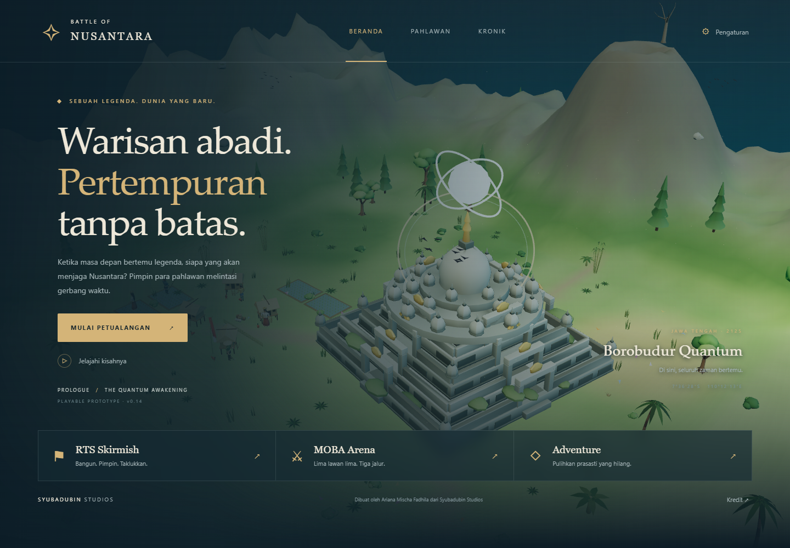

## Pasang / Install

Unduh `BattleNusantara-<versi>-win-x64-setup.exe` dari halaman [Releases](https://github.com/SyubadubinStudios/BattleNusantara/releases) dan jalankan. Installer memasang permainan untuk pengguna saat ini (tanpa hak administrator) dan, bila dipilih, server LAN. Windows 10 (19041) atau lebih baru dan Microsoft Edge WebView2 Runtime diperlukan; Windows 11 sudah memilikinya. Installer belum ditandatangani secara digital, sehingga Windows SmartScreen dapat memperingatkan.

Download `BattleNusantara-<version>-win-x64-setup.exe` from [Releases](https://github.com/SyubadubinStudios/BattleNusantara/releases) and run it. It installs the game for the current user (no administrator rights) and, if chosen, the LAN server. It needs Windows 10 (19041) or later and the Microsoft Edge WebView2 Runtime, which Windows 11 already has. The installer is not code-signed, so Windows SmartScreen may warn.

**Linux dan macOS (v0.14).** Unduh `BattleNusantara-<versi>-linux-x64.tar.gz`, `-osx-arm64.zip` (Apple silicon) atau `-osx-x64.zip` (Intel). Linux: ekstrak lalu jalankan `./play.sh`; perlu WebKitGTK 4.1, GTK 3 dan libnotify (`sudo apt install libwebkit2gtk-4.1-0 libgtk-3-0 libnotify4`). macOS 12+: buka `Battle of Nusantara.app`; aplikasi ditandatangani ad hoc tetapi belum dinotarisasi, jadi pertama kali klik kanan lalu pilih **Open** (atau `xattr -dr com.apple.quarantine "Battle of Nusantara.app"`). Setiap paket juga berisi server LAN (`lan-server.sh` / `LAN Server/lan-server.command`), yang dapat dimainkan dari browser apa pun di `http://<komputer>:5080`.

**Linux and macOS (v0.14).** Download `BattleNusantara-<version>-linux-x64.tar.gz`, `-osx-arm64.zip` (Apple silicon) or `-osx-x64.zip` (Intel). Linux: extract and run `./play.sh`; it needs WebKitGTK 4.1, GTK 3 and libnotify (`sudo apt install libwebkit2gtk-4.1-0 libgtk-3-0 libnotify4`). macOS 12+: open `Battle of Nusantara.app`; it is signed ad hoc but not notarized, so the first time right-click it and choose **Open** (or `xattr -dr com.apple.quarantine "Battle of Nusantara.app"`). Each download also holds the LAN server (`lan-server.sh` / `LAN Server/lan-server.command`), playable from any browser at `http://<computer>:5080`. The desktop game there is a Photino window (the system WebKit) around the same game as on Windows.

```powershell
./scripts/package.ps1          # artifacts/installer/BattleNusantara-<version>-win-x64-setup.exe (needs Inno Setup 6)
python scripts/package_unix.py # artifacts/installer/*-linux-x64.tar.gz, *-osx-arm64.zip, *-osx-x64.zip
```

Rilis Linux dan macOS dibangun oleh GitHub Actions (`.github/workflows/release.yml`) pada sistemnya masing-masing, karena macOS Apple silicon hanya menjalankan program yang ditandatangani. / The Linux and macOS downloads are built by GitHub Actions on their own systems, because Apple silicon only runs signed programs.

## Jalankan dari sumber / Run from source

Prasyarat / Prerequisites: .NET SDK 10, Windows untuk desktop WPF, WebView2 Evergreen Runtime, browser dengan WebGL2. Node.js 22+ dan Microsoft Edge hanya diperlukan untuk memperbarui aset vendor dan menjalankan tes browser. Gunakan runtime .NET 10 dengan patch keamanan terkini untuk deployment.

```powershell
dotnet restore BattleNusantara.slnx
dotnet build BattleNusantara.slnx -c Release

# Browser + server: http://localhost:5080
dotnet run --project src/BattleNusantara.Server -c Release --no-launch-profile --urls http://localhost:5080

# Desktop Windows; permainan solo tidak memerlukan server
# Windows desktop; solo play does not require a server
dotnet run --project src/BattleNusantara.Desktop -c Release

# macOS / Linux desktop (Photino; also runs on Windows)
dotnet run --project src/BattleNusantara.Photino -c Release
```

Aset Three.js dan GLB tersedia lokal; permainan tidak mengambil aset dari CDN. / Three.js and GLB assets are local; gameplay does not fetch assets from a CDN.

Self-contained builds for the installer are published by `scripts/package.ps1` into `artifacts/publish/`. / Build mandiri untuk installer dipublikasikan oleh `scripts/package.ps1` ke `artifacts/publish/`.

## Mainkan / Play

Pilih mode dan hero melalui **Mulai petualangan**. Klik tanah untuk bergerak; serangan berlangsung otomatis dalam jangkauan. **Q** mengaktifkan ultimate, **Esc** membuka jeda. Candi sendiri memulihkan HP. / Select a mode and hero. Click the ground to move, attack automatically in range, press **Q** for the ultimate and **Esc** to pause. Your shrine heals you.

| Mode | Tersedia / Available |
| --- | --- |
| RTS Skirmish | Pasukan, pekerja tambang, pos penyetoran, upgrade, hancurkan gerbang; tiga peta / Troops, mining workers, drop-off outposts, upgrades, destroy the gate; three maps |
| MOBA Arena | 5v5 dengan hero AI, menara, item, respawn, dan boss netral; tiga peta / 5v5 with AI heroes, towers, items, respawns and a neutral boss; three maps |
| Adventure | Temukan tiga prasasti dan kalahkan boss / Recover three inscriptions and defeat the boss |
| Semua mode / Every mode | Kamp monster dengan harta, hewan liar, penduduk desa / Jungle camps with treasure, wildlife, villagers |
| LAN co-op | Ruang dua pemain melawan AI, emas bersama, cooldown terpisah / Two-player rooms against AI, shared gold, separate cooldowns |

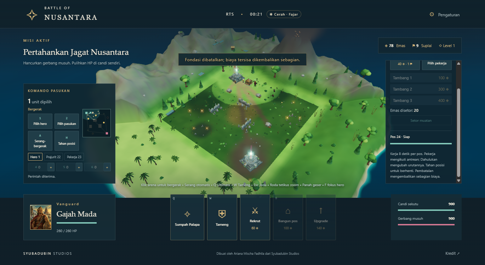

## Taktik RTS / RTS tactics — v0.2

**1** memilih hero, **2** memilih pasukan sendiri (maksimal 24). Klik unit atau gunakan daftar unit; **Shift+klik** menambah pilihan. Klik tanah/peta taktis untuk bergerak dalam formasi. **A**, lalu klik tujuan, memerintahkan serang-bergerak; **H** menahan posisi. **Esc** membatalkan penentuan tujuan serangan sebelum membuka jeda. Unit menghindari reruntuhan; tujuan di dalam rintangan ditolak tanpa mengubah perintah sebelumnya.

**1** selects your hero; **2** selects your troops (up to 24). Click units or use the roster; **Shift-click** adds to selection. Click ground/the tactical map to move in formation. **A**, then a destination, issues attack-move; **H** holds position. **Esc** cancels attack targeting before opening pause. Units route around ruins; blocked destinations leave the previous order intact. Both LAN clients must use the same version.

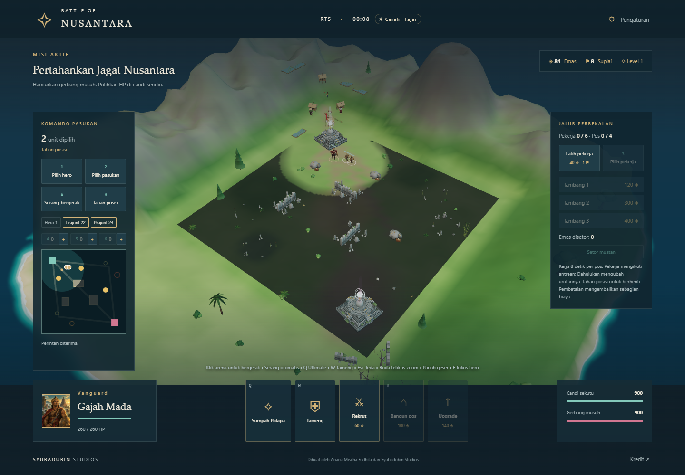

## Ekonomi RTS / RTS economy — v0.3

Latih pekerja seharga **40 emas / 1 suplai**, tekan **3**, lalu pilih tambang. Muatan **20 emas** baru masuk ke kas bersama setelah disetor. **B**, lalu klik arena/peta, menempatkan pos penyetoran seharga **100 emas**; **Esc** membatalkan. Pos tidak lagi memberi pendapatan pasif. Batas: 6 pekerja per pemain, 4 pos per ruang. Tombol **Setor muatan** menyelesaikan pengantaran tanpa melanjutkan tambang.

Train workers for **40 gold / 1 supply**, press **3**, then choose a mine. Each **20-gold** load enters the shared treasury only after delivery. **B**, then click the arena/map, places a **100-gold** drop-off outpost; **Esc** cancels. Outposts no longer generate passive income. Limits: 6 workers per player, 4 outposts per room. **Return cargo** deposits carried gold and then idles.

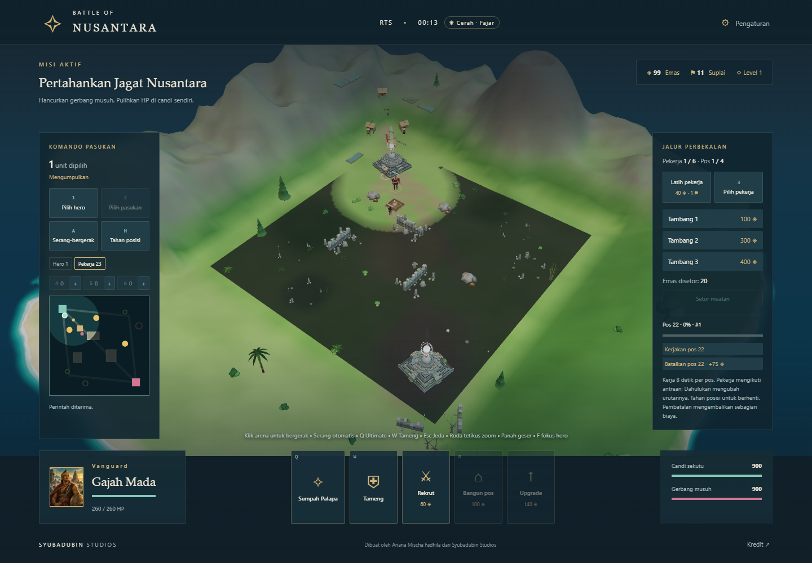

## Navigasi dinamis / Dynamic navigation — v0.4

Pos menghalangi gerakan. Unit mengitari tapak bangunan, pekerja menyetor dari tepi, dan jalur terbuka lagi saat pos hancur. Titik muncul unit dilindungi dari pembangunan. Berlaku pada solo dan LAN.

Outposts block movement. Units route around buildings, workers deposit from outside, and paths reopen after destruction. Spawn points are protected from construction. Shared by solo and LAN.

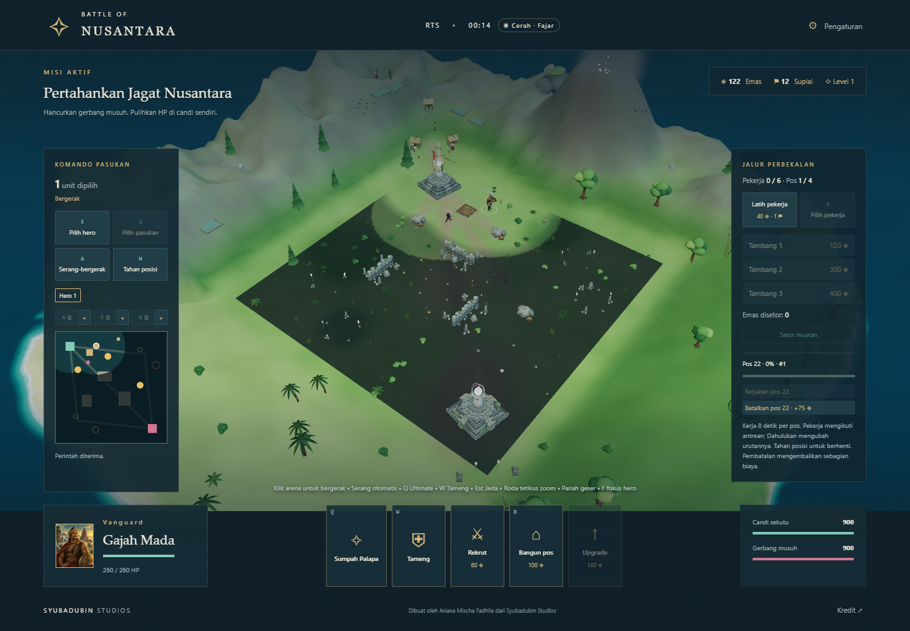

## Konstruksi pekerja / Worker construction — v0.5

Tekan **B** untuk menempatkan fondasi seharga 100 emas. Pekerja diam otomatis ditugaskan; jika belum ada, latih dan pilih pekerja lalu tekan **Kerjakan pos**. Pos membutuhkan 8 detik kerja setelah pekerja tiba dan baru menerima setoran pada progres 100%. Perintah lain menghentikan pembangunan; progres tetap tersimpan untuk dilanjutkan.

Press **B** to place a foundation for 100 gold. An idle worker is assigned automatically; otherwise train/select a worker and choose **Work on outpost**. Construction takes 8 seconds after arrival and deposits unlock at 100%. Other orders interrupt construction while preserving progress for resumption.

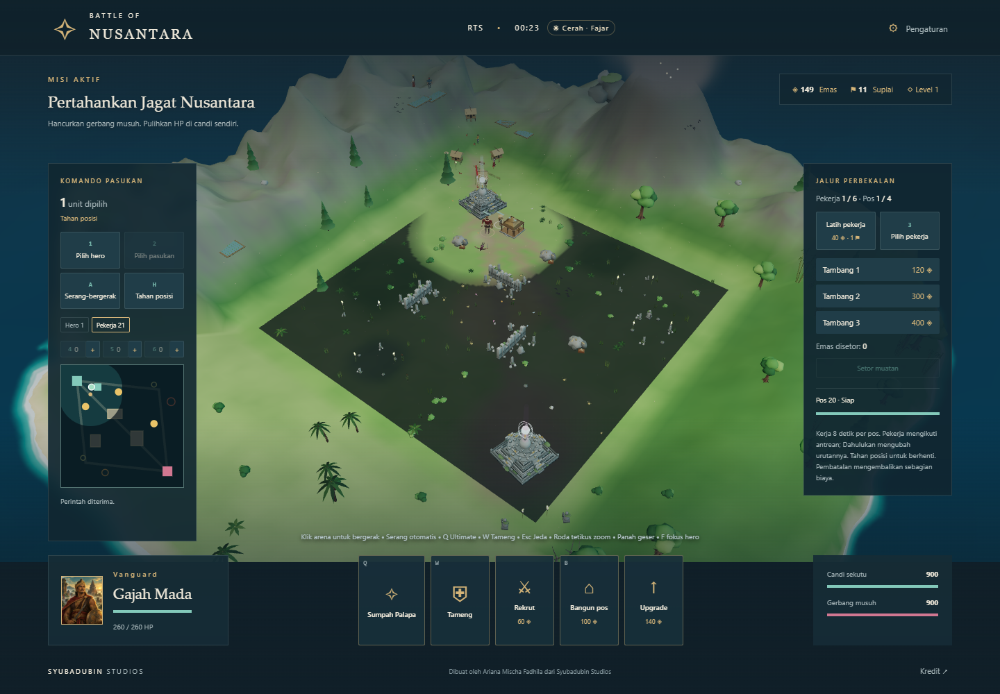

## Antrean dan pembatalan / Queues and cancellation — v0.6

Setelah selesai, pekerja melanjutkan fondasi milikmu yang belum ditangani, sesuai urutan penempatan. **Tahan posisi** menghentikan pekerja; **Kerjakan pos** memilih pekerjaan berikutnya secara manual. **Batalkan pos** menghapus fondasi dan membuka jalur, dengan pengembalian maksimum 75 emas yang berkurang sesuai progres. Jumlahnya terlihat pada tombol; pos selesai tidak dapat dibatalkan.

Builders continue to owned unstaffed foundations in placement order. **Hold** stops a worker; **Work on outpost** selects a job manually. **Cancel outpost** removes a foundation and reopens the path, refunding up to 75 gold scaled down by completed work. The button shows the refund; completed outposts cannot be cancelled.

Perbaikan navigasi: pekerja kini mencapai titik sudut sebelum berbelok, sehingga tidak macet saat mengitari beberapa pos. / Navigation fix: workers reach each corner before turning, preventing stalls around multiple outposts.

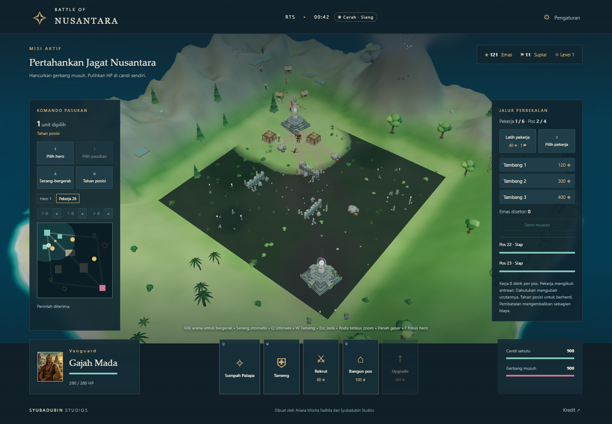

## Seleksi kotak dan grup kontrol / Box selection and control groups — v0.7

Seret kotak di arena dengan tombol kiri mouse untuk memilih semua unit milikmu di dalamnya (maksimal 24); **Shift+seret** menambah ke pilihan. Kotak kosong tidak mengubah pilihan. **Ctrl+4–6** menyimpan pilihan sebagai grup, **4–6** memanggilnya; di browser yang memakai Ctrl+angka untuk berpindah tab, gunakan **Alt+4–6** atau tombol **+** pada panel. Unit yang gugur dikeluarkan dari grup secara otomatis. Grup berlaku untuk satu pertandingan dan hanya tersimpan di perangkatmu.

Drag a box on the arena with the left mouse button to select every unit you own inside it (up to 24); **Shift-drag** adds to the selection. An empty box leaves the selection unchanged. **Ctrl+4–6** saves the selection as a group and **4–6** recalls it; where the browser uses Ctrl+digit to switch tabs, use **Alt+4–6** or the panel's **+** buttons. Fallen units leave their groups automatically. Groups last for one match and are stored only on your device. Box selection needs a mouse or pen; on touch screens use the unit roster.

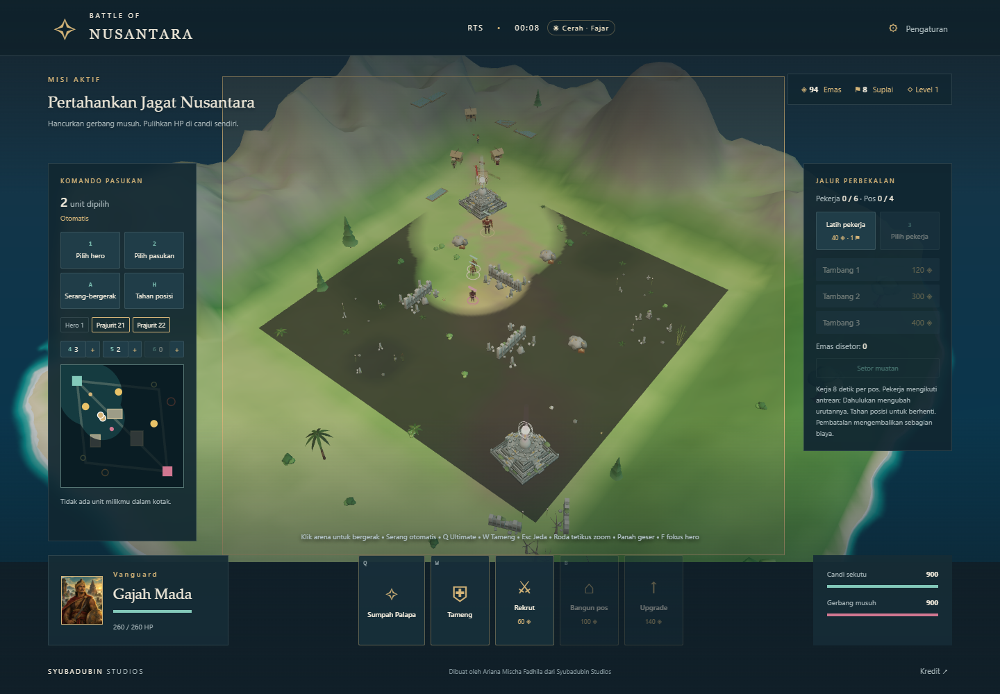

## Kabut perang dan urutan antrean / Fog of war and queue order — v0.8

Di mode RTS, musuh hanya terlihat di dalam jangkauan pandang timmu: candi (24), hero (26), prajurit (18), pekerja (14), pos selesai (20), dan fondasi (8). Pandangan dibagi dengan rekan LAN. Server tidak mengirim musuh yang tersembunyi, jadi klien tidak dapat mengintip. Arena menggelapkan wilayah yang belum dijelajahi dan meredupkan wilayah yang pernah dilihat; peta taktis menampilkan pandangan saat ini. Tambang, reruntuhan, dan gerbang musuh selalu terlihat. MOBA dan Adventure tidak memakai kabut.

In RTS mode, enemies are visible only inside your team's vision: shrine (24), hero (26), soldier (18), worker (14), finished outpost (20) and foundation (8). Vision is shared with your LAN teammate. The server does not send hidden enemies, so a client cannot peek. The arena darkens unexplored ground and dims ground seen earlier; the tactical map shows current vision. Mines, ruins and the enemy gate are always visible. MOBA and Adventure have no fog.

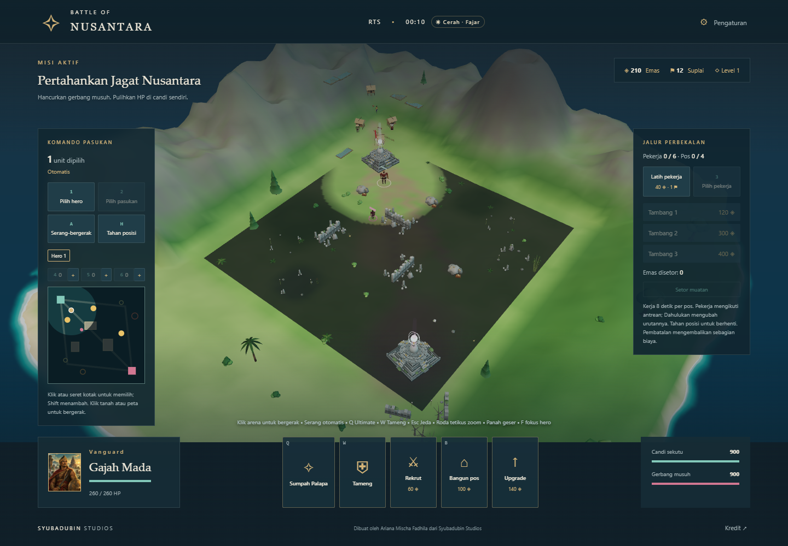

Setiap fondasi menampilkan nomor antreannya (**#1**, **#2**, …). **Dahulukan pos** memindahkan fondasi ke depan antreanmu; pekerja mengambilnya setelah pekerjaan saat ini selesai. Gunakan **Kerjakan pos** untuk memindahkan pekerja saat itu juga.

Each foundation shows its queue number (**#1**, **#2**, …). **Prioritize outpost** moves a foundation to the front of your queue; builders take it once their current job ends. Use **Work on outpost** to move a builder immediately.

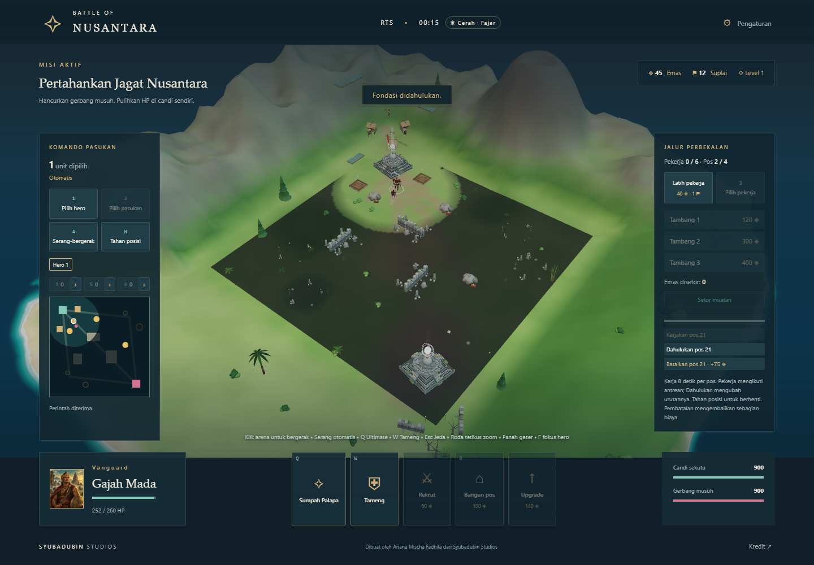

## MOBA 5v5 — v0.9

MOBA Arena kini mempertemukan lima hero melawan lima: kamu, empat sekutu AI (Diponegoro, Pattimura, Si Pitung, Barong), dan lima lawan AI (Rangda, Leak, Buto Ijo, Kuntilanak, Pocong). Rekan LAN menggantikan satu sekutu AI. Setiap sisi memiliki satu menara per jalur; candi dan gerbang baru dapat diserang setelah salah satu menara sisinya runtuh. Hero yang gugur bangkit di candi setelah 10 detik, jadi kekalahan hanya terjadi bila candi hancur. Toko menjual tiga item, masing-masing hingga level 3 dengan harga yang naik: **Keris Pusaka** (+12 serangan), **Perisai Rotan** (+90 HP), dan **Terompah Angin** (+20% kecepatan). Item tetap ada setelah bangkit dan dapat dibeli saat menunggu. **Naga Basuki**, boss netral di timur, hanya melawan hero pemain; menaklukkannya memberi 150 emas dan Restu (+25% serangan hero tim selama 60 detik). Ia kembali setelah 90 detik.

MOBA Arena now pits five heroes against five: you, four AI allies (Diponegoro, Pattimura, Si Pitung, Barong) and five AI opponents (Rangda, Leak, Buto Ijo, Kuntilanak, Pocong). A LAN teammate replaces one AI ally. Each side has one tower per lane; a shrine or gate can be attacked only after one of its side's towers falls. Fallen heroes return at their shrine after 10 seconds, so you lose only when the shrine is destroyed. The shop sells three items, each up to level 3 at a rising price: **Heirloom Keris** (+12 attack), **Rattan Shield** (+90 HP) and **Wind Sandals** (+20% speed). Items survive respawns and can be bought while waiting. **Naga Basuki**, the neutral boss to the east, fights only player heroes; defeating it grants 150 gold and a Blessing (+25% attack for your team's heroes for 60 seconds). It returns after 90 seconds.

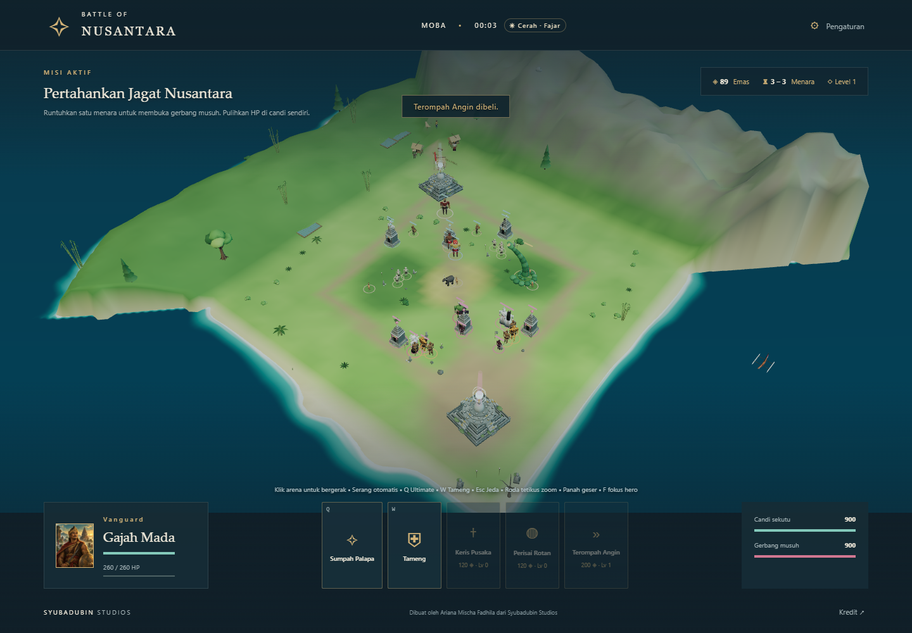

## Fase 2 selesai / Phase 2 complete — v0.10

**Adventure** kini memiliki cerita: lima misi yang saling bergantung, dialog dwibahasa, Gua Mistis yang pintunya baru terbuka setelah lima penjaga jalan tumbang, Keris Pusaka Jagat, dan Sang Kalatidha yang tidak dapat dilukai sampai prasasti dan pusaka terkumpul. Permainan solo dapat disimpan dari menu jeda dan dilanjutkan dari menu utama.

**Adventure** now has a story: five interdependent quests, bilingual dialogue, a Mystic Cave whose door opens only after the five road guardians fall, the Jagat Heirloom Keris, and Sang Kalatidha, who cannot be harmed until the inscriptions and the heirloom are gathered. A solo run can be saved from the pause menu and resumed from the main menu.

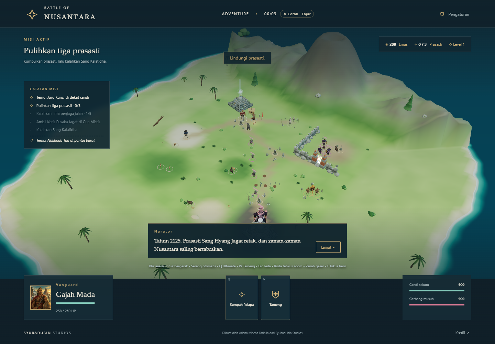

Setiap hero memiliki kemampuan kedua, **Tameng (W)**: memulihkan 20% HP dan menghalau separuh kerusakan selama 4 detik, dengan jeda 12 detik. Di **MOBA**, hero naik level sampai 6 dari pengalaman, menara menembak pasukan lebih dahulu daripada hero, hero AI bertambah kuat seiring waktu, dan musuh dapat merebut Restu Naga Basuki. Di **RTS**, reruntuhan menghalangi pandangan, musuh hanya menyerang yang dapat mereka lihat, dan pos hanya dapat didirikan di tanah yang sudah dijelajahi.

Every hero has a second ability, **Guard (W)**: it restores 20% HP and halves incoming damage for 4 seconds, on a 12-second cooldown. In **MOBA**, heroes level up to 6 from experience, towers shoot troops before heroes, AI heroes grow stronger over time, and the enemy can claim Naga Basuki's Blessing. In **RTS**, ruins block sight, enemies attack only what they can see, and outposts can be founded only on explored ground.

**LAN**: koneksi yang terputus menyambung ulang otomatis ke kursi yang ditahan selama 60 detik; pemain yang keluar menyerahkan unitnya kepada rekan; dan hingga delapan penonton dapat menonton sebuah ruang dengan kodenya tanpa mengambil kursi pemain.

**LAN**: a dropped connection reconnects automatically to a seat held for 60 seconds; a player who leaves hands their units to the teammate; and up to eight spectators can watch a room by its code without taking a player seat.

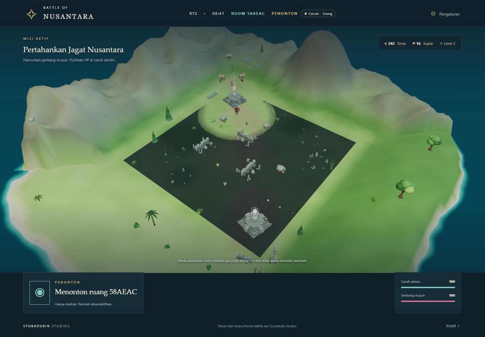

Pertandingan penuh RTS, MOBA dan Adventure kini diuji dengan pemain terskrip yang harus menang secara identik di setiap jalan, dan anggaran performa dijaga oleh tes: lihat [docs/PERFORMANCE.md](docs/PERFORMANCE.md). Keseimbangan MOBA belum diuji oleh pemain manusia, dan performa belum diukur pada perangkat target.

Full RTS, MOBA and Adventure matches are now tested with scripted players that must win identically on every run, and performance budgets are enforced by tests: see [docs/PERFORMANCE.md](docs/PERFORMANCE.md). MOBA balance has not been playtested by people, and performance has not been measured on target hardware.

## Inti platform / Platform core — v0.11

Server kini memiliki **akun**: daftar dan masuk dari menu **Mulai petualangan → Akun dan matchmaking**. Akun menyimpan hasil pertandinganmu (menang/kalah, mode, hero, durasi) dan membuka **matchmaking**: pilih mode, tekan **Cari pertandingan**, dan server memasangkanmu dengan pemain lain yang menunggu mode yang sama. Bermain dengan kode ruang tetap dapat dilakukan tanpa akun. Ruang co-op kini memuat **hingga 10 pemain** (5 di MOBA).

The server now has **accounts**: register and sign in from **Begin your adventure → Account and matchmaking**. An account keeps your match results (win/loss, mode, hero, duration) and unlocks **matchmaking**: pick a mode, press **Find a match**, and the server pairs you with another player waiting for the same mode. Playing by room code still works without an account. Co-op rooms now hold **up to 10 players** (5 in MOBA).

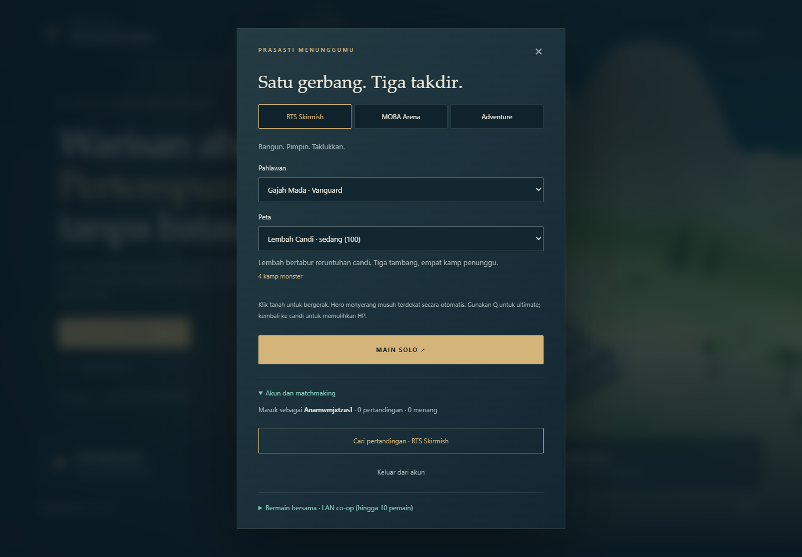

Data akun disimpan di basis data SQLite tertanam (`src/BattleNusantara.Server/data/`), dengan skrip backup dan restore. Satu server pada mesin pengembangan menahan 32 ruang × 10 pemain tanpa tick terlambat. Jalur PostgreSQL dan Redis baru dijalankan pada v0.12 (lihat di bawah); server belum diuji di internet maupun pada lebih dari satu host: lihat [docs/OPERATIONS.md](docs/OPERATIONS.md).

Account data lives in an embedded SQLite database (`src/BattleNusantara.Server/data/`), with backup and restore scripts. One server on the development machine held 32 rooms × 10 players without a late tick. The PostgreSQL and Redis paths were first run in v0.12 (see below); the server has not been tested on the internet or on more than one host: see [docs/OPERATIONS.md](docs/OPERATIONS.md).

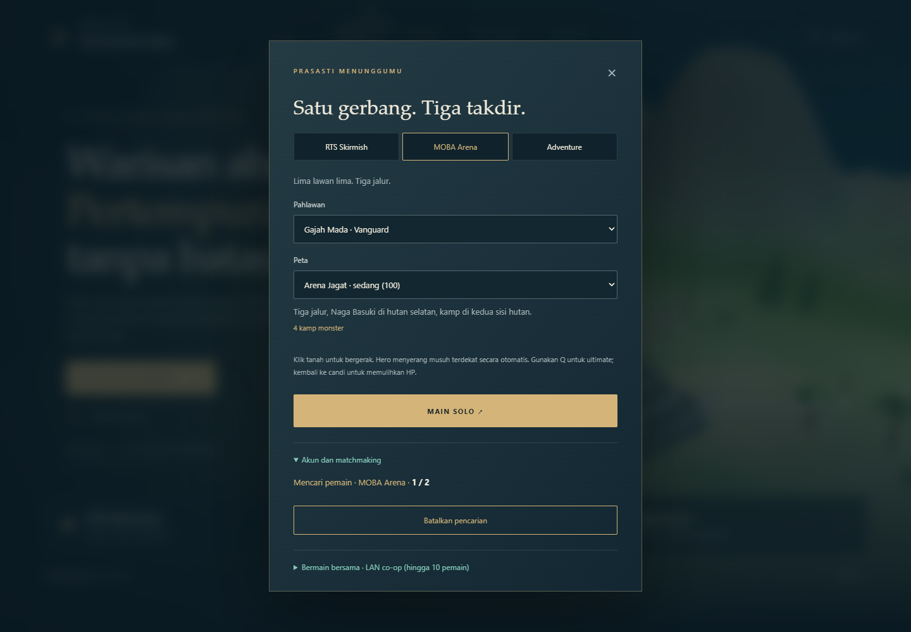

Server memakai HTTP biasa: gunakan hanya di LAN tepercaya, atau di belakang HTTPS. / The server speaks plain HTTP: use it only on a trusted LAN, or behind HTTPS.

Semua klien dan server LAN harus memakai versi 0.11. / All LAN clients and servers must run version 0.11.

## Seni dan dunia / Art and world — v0.12

Pahlawan, pasukan, penjaga, dan boss kini berupa **prajurit low-poly ber-rig** buatan Blender dengan animasi diam, berjalan, dan menyerang, menggantikan penanda geometris. Setiap pertandingan dibuka dengan **sinematik singkat** (dapat dilewati dengan tombol apa pun, dapat dimatikan di Pengaturan). Langit mengikuti jam pertandingan: **siang–malam** enam menit serta **cerah, kabut, hujan, dan badai**, dengan laut yang berombak dan audio yang ikut berubah: hujan terdengar, dan lapisan tegang serta dentum genderang muncul saat pertempuran. Cuaca hanya tampilan dan tidak mengubah aturan permainan.

Heroes, troops, guardians and bosses are now a **rigged low-poly warrior** made in Blender with idle, walk and attack animations, replacing the geometric markers. Every match opens with a **short cinematic** (any key skips it; Settings can switch it off). The sky follows the match clock: a six-minute **day and night** and **clear, mist, rain and storm**, with a rolling ocean and audio that changes with it: rain is heard, and a tense layer with drum hits comes in during fights. Weather is visual only and never changes the rules.

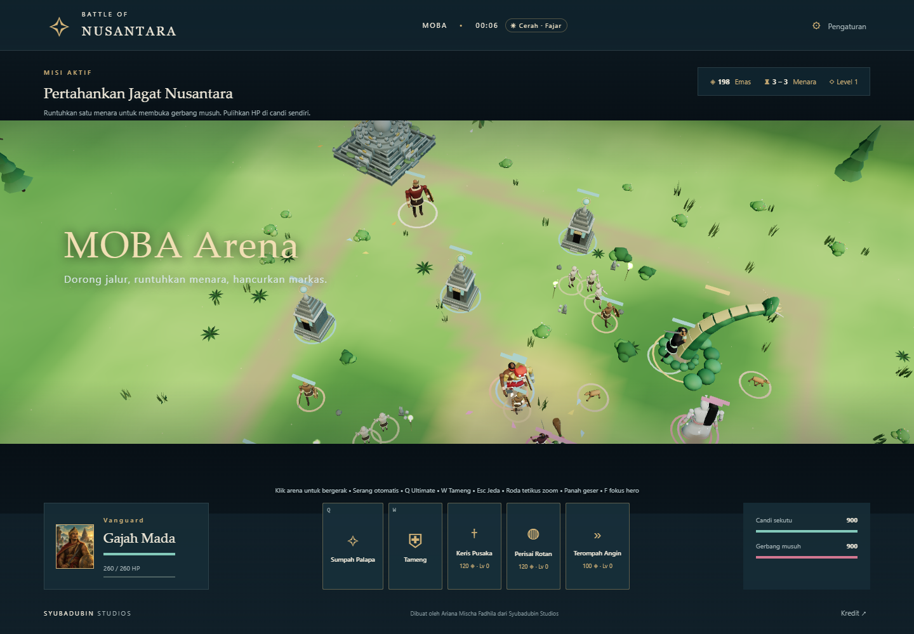

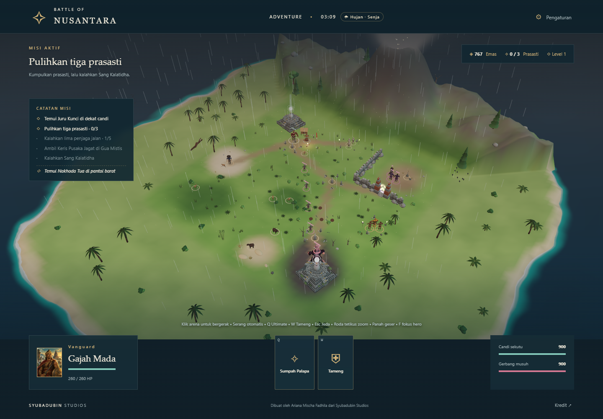

Di Adventure, dunia bercerita lewat benda: perkemahan Juru Kunci dengan api unggun, reruntuhan candi kecil di sekitar tiap prasasti, bekas medan perang, dan bangkai kapal di karang barat. Setelah bertemu Juru Kunci, berdirilah di dekatnya untuk **bertanya** tiga hal. Jawabannya berasal dari naskah; bila server diberi model bahasa (Semantic Kernel + Azure OpenAI, mati secara bawaan), jawabannya disusun model itu dan diberi label **jawaban AI**. Bila model lambat, gagal, atau melewati anggaran, naskah yang tampil.

In Adventure the world tells its story through objects: the Keeper's camp with a fire, the remains of a small shrine around each inscription, an old battlefield and a wreck on the western reef. Once you have met the Keeper, stand beside him to **ask** three things. The answers are authored; when the server is given a language model (Semantic Kernel + Azure OpenAI, off by default) the model words the answer and it is labelled **AI reply**. If the model is slow, fails or is over budget, the authored text is shown.

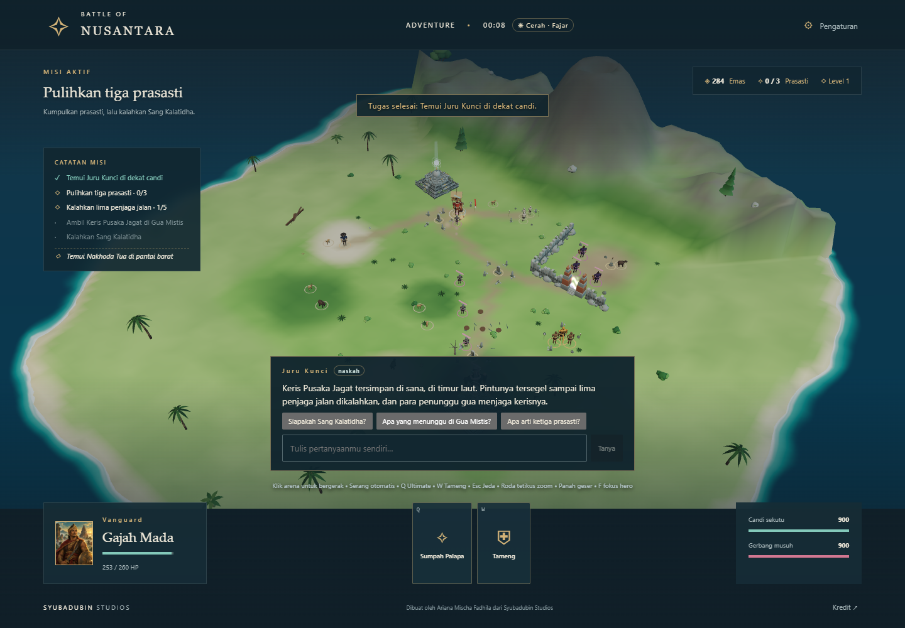

WebGPU diukur pada mesin pengembangan dan **lebih lambat** daripada WebGL2 di sana, sehingga game tetap memakai WebGL2; ray tracing dan penghancuran hanya dinilai di atas kertas. Lihat [docs/RENDERING.md](docs/RENDERING.md). Jalur PostgreSQL dan antrean Redis dari v0.11 kini **sudah dijalankan dan diuji** terhadap PostgreSQL 17 dan Garnet (server berprotokol Redis; bukan Redis itu sendiri): lihat [docs/OPERATIONS.md](docs/OPERATIONS.md).

WebGPU was measured on the development machine and was **slower** than WebGL2 there, so the game stays on WebGL2; ray tracing and destruction were assessed on paper only. See [docs/RENDERING.md](docs/RENDERING.md). The PostgreSQL path and the Redis queue from v0.11 have now **been run and tested** against PostgreSQL 17 and Garnet (a Redis-protocol server, not Redis itself): see [docs/OPERATIONS.md](docs/OPERATIONS.md).

Protokol LAN tidak berubah sejak 0.11. Cuaca dihitung tiap klien dari tick, sehingga semua klien 0.12 dalam satu ruang melihat langit yang sama. / The LAN protocol is unchanged since 0.11. Each client derives the weather from the tick, so all 0.12 clients in a room see the same sky.

## Fase 4 selesai / Phase 4 complete — v0.13

Setiap unit kini memiliki **model Blender sendiri**: 24 karakter pada satu rig dengan enam animasi (diam, jalan, serang, jurus, terkena, gugur), Naga Basuki dengan rig ularnya sendiri, serta menara candi, pendopo pos, prasasti, keris pusaka, tambang emas, dan serpihan kapal. Kartu pemilihan hero memakai potret lukis.

Every unit now has **its own Blender model**: 24 characters on one rig with six animations (idle, walk, attack, cast, hit, death), Naga Basuki on its own serpent rig, and a candi tower, a pendopo outpost, an inscription stone, the heirloom keris, a gold mine and ship fragments. The hero cards show painted portraits.

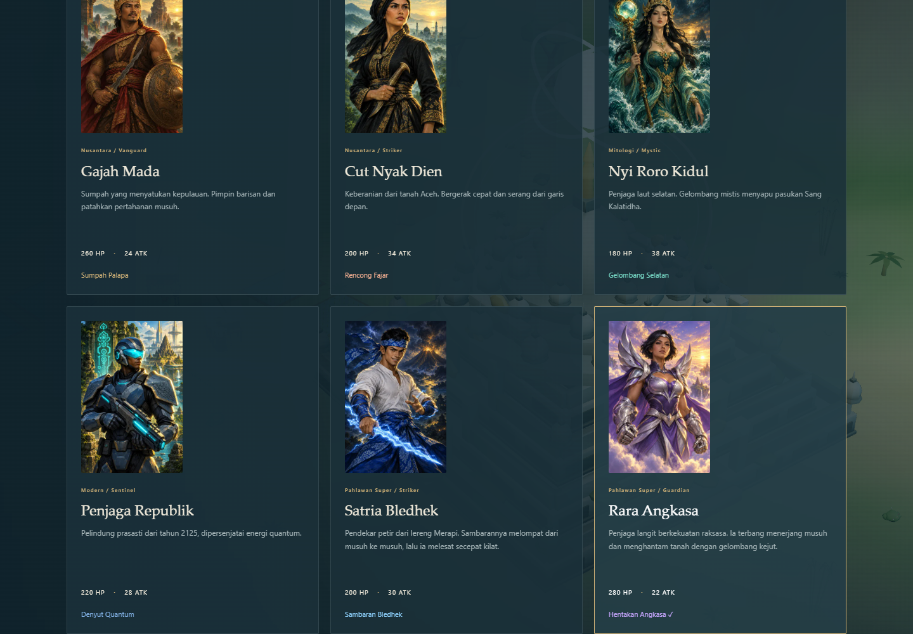

**Faksi Pahlawan Super** hadir dengan dua hero orisinal, bukan tokoh komik berlisensi: **Satria Bledhek**, yang petirnya melompat dari musuh ke musuh lalu melesat cepat, dan **Rara Angkasa**, yang terbang menerjang musuh lalu menghantam dengan gelombang kejut. Keduanya punya jurus sendiri di simulasi, bukan sekadar tampilan.

The **Superhero faction** arrives with two original heroes rather than licensed comic characters: **Satria Bledhek**, whose lightning leaps from foe to foe before he darts away, and **Rara Angkasa**, who flies onto the enemy and strikes with a shockwave. Both have their own ultimates in the simulation, not just a different look.

Adventure dibuka dengan **cutscene** yang menyusuri karang barat, perkemahan Juru Kunci, dan Gua Mistis, dan ditutup dengan adegan akhir. Semua dialog kini **bersuara** dalam bahasa Indonesia dan Inggris, dan **musik gamelan** yang digubah untuk game ini berubah saat pertempuran. Kabut dan badai kini **memperpendek jarak pandang** semua unit. Pantai berbuih, dan hujan menimbulkan riak di laut.

Adventure opens with a **cutscene** past the western reef, the Keeper's camp and the Mystic Cave, and closes with an ending scene. All dialogue is now **voiced** in Indonesian and English, and **gamelan music** composed for the game changes when fighting starts. Mist and storm now **shorten the sight** of every unit. The shore foams, and rain ripples the sea.

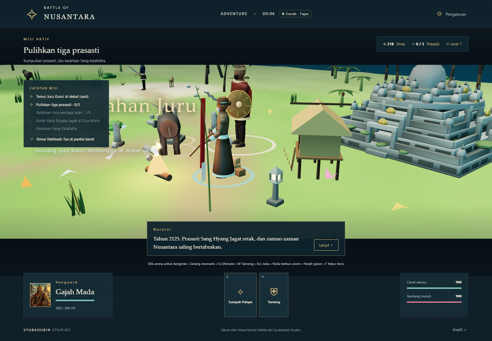

Di pantai barat menunggu **Nakhoda Tua** dengan **tugas sampingan yang dibangkitkan** dari benih pertandingan: mengumpulkan serpihan kapal atau mengusir arwah laut, tiga atau empat, di tempat berbeda setiap kali. Juru Kunci dan Nakhoda kini dapat ditanya dengan **kalimat sendiri**. Tanpa model bahasa, pertanyaan diarahkan lewat kata kunci ke jawaban naskah; dengan model, jawabannya disusun dari fakta naskah saja.

On the western shore waits the **Old Captain** with a **side quest generated** from the match seed: gather ship fragments or drive off sea spirits, three or four of them, in different places each time. The Keeper and the Captain can now be asked **in your own words**. Without a language model the question is routed by keyword to an authored answer; with one, the reply is composed from the authored facts only.

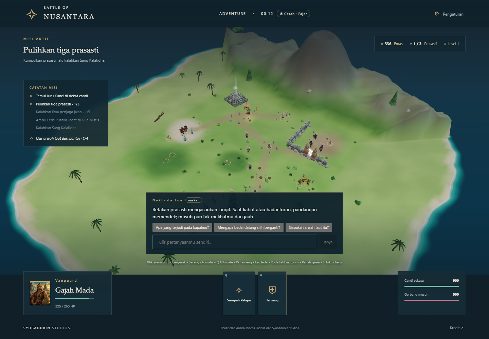

Versi 0.13 mengubah snapshot (`UnitView.Model`): semua klien dan server LAN harus memakai 0.13. Simpanan Adventure dari 0.10–0.12 tetap dapat dimuat. / Version 0.13 changes the snapshot (`UnitView.Model`): all LAN clients and servers must run 0.13. Adventure saves from 0.10–0.12 still load.

## Dunia yang hidup / A living world — v0.14

**Tujuh peta dalam tiga ukuran.** RTS: Lembah Candi (sedang), Pesisir Selatan (kecil, di antara dua laguna), dan Hutan Larangan (besar, dengan rumpun yang menutup pandangan). MOBA: Arena Jagat (sedang), Gelanggang Sabana (kecil), dan Jembatan Naga (besar, dibelah sungai dengan tiga jembatan). Adventure: Pulau Prasasti. Pilih peta di panel bermain; ukuran tertulis di sampingnya. Setiap peta adalah pulau ala Warcraft: gunung dan **gunung api berasap** di cakrawala, pantai berbuih dengan laut dangkal berwarna toska, danau dan sungai, hutan, sawah, sabana, rawa, gurun, dan tanah tandus, dengan pepohonan yang bergoyang tertiup angin. Desa di belakang candi sekutu dihuni penduduk yang bekerja di sawah dan berlari pulang saat pertempuran mendekat.

**Seven maps in three sizes.** RTS: Temple Valley (medium), Southern Shore (small, between two lagoons) and Forbidden Forest (large, with groves that block sight). MOBA: Jagat Arena (medium), Savanna Ring (small) and Dragon Bridges (large, split by a river with three bridges). Adventure: Inscription Isle. Pick the map in the play panel; its size is shown beside it. Every map is a Warcraft-style island: mountains and a **smoking volcano** on the horizon, foaming beaches over turquoise shallows, lakes and rivers, forest, rice fields, savanna, swamp, desert and barren land, with trees that sway in the wind. The village behind the allied shrine is home to villagers who work the fields and run indoors when fighting comes near.

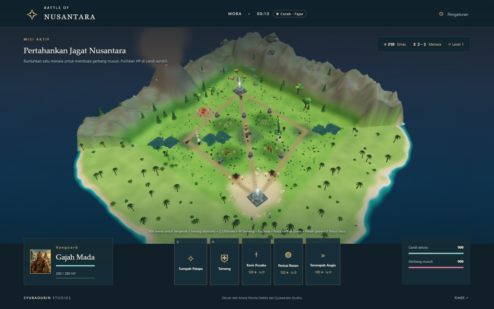

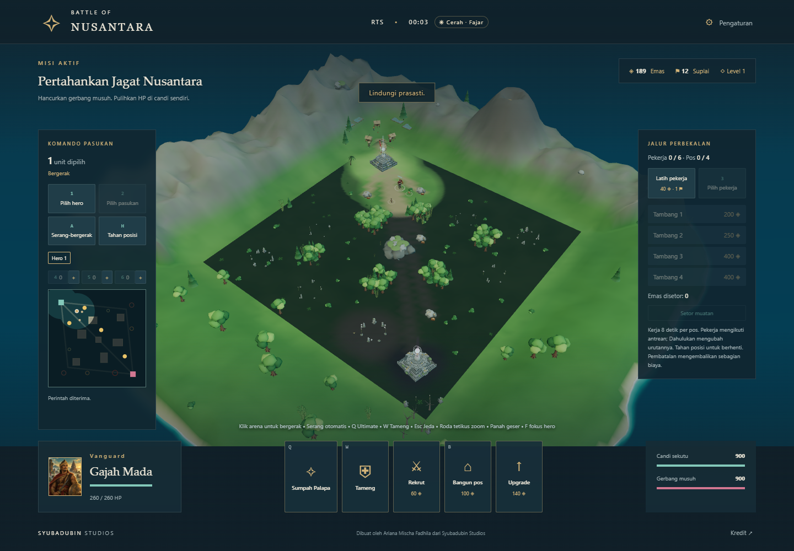

**Kamp monster dan harta.** Seperti creep netral di Warcraft III dan Dota, setiap peta punya kamp penunggu dalam empat tingkat: **Lemah** (tiga tuyul), **Sedang** (siluman kera dan siluman macan), **Kuat** (siluman buaya dan genderuwo), dan **Purba** (Banaspati, roh api, dengan pengawal siluman macan). Monster menjaga kampnya, mengejar sampai batas tertentu lalu pulang memulihkan diri, dan muncul lagi satu sampai empat menit setelah dikalahkan. Kamp yang ditaklukkan menjatuhkan **harta sesuai kesulitannya**: jamu dan batu asah dari kamp lemah, keris luk tujuh dan zirah sisik naga dari kamp kuat, Mustika Banaspati dan peti harta dari kamp purba. Hero yang melangkahi harta mengambilnya untuk **peningkatan permanen** selama pertandingan (serangan, HP, kecepatan, pemulihan, atau emas); temuanmu tampil di panel hero.

**Jungle camps and treasure.** Like neutral creeps in Warcraft III and Dota, every map has guarded camps in four tiers: **Weak** (three tuyul), **Medium** (monkey and tiger siluman), **Strong** (crocodile siluman and a genderuwo) and **Ancient** (Banaspati, a fire spirit, guarded by tiger siluman). Monsters guard their camp, chase only so far before walking home to heal, and return one to four minutes after they fall. A cleared camp drops **treasure that matches its difficulty**: tonics and whetstones from weak camps, a seven-wave keris and dragon-scale mail from strong ones, the Banaspati gem and a treasure chest from ancient ones. A hero who walks over treasure takes it for a **permanent upgrade** for the rest of the match (attack, HP, speed, healing or gold); your finds are listed in the hero panel.

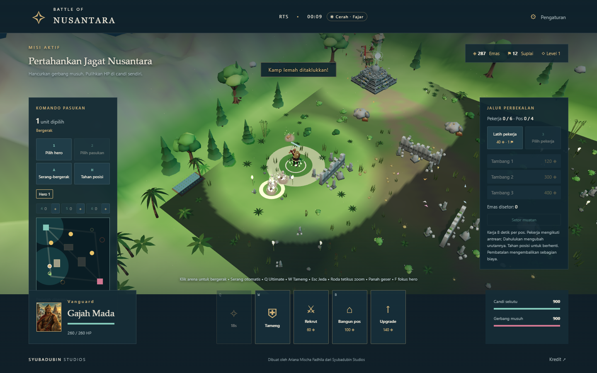

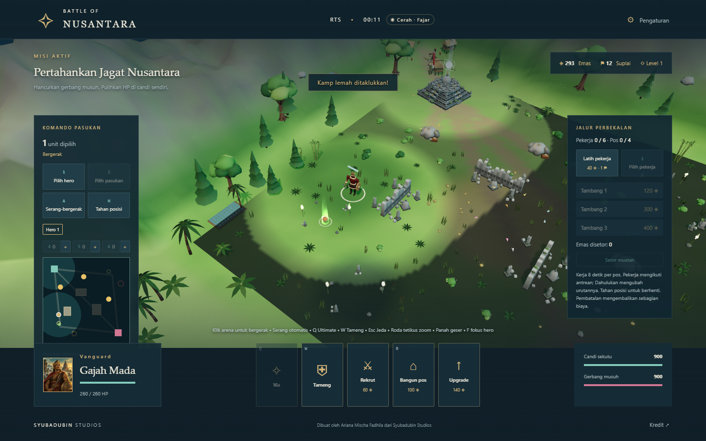

**Hewan liar.** Tidak semua makhluk adalah monster. Kancil yang pemalu lari menjauh, kerbau tenang merumput sampai diganggu, babi hutan menyeruduk siapa pun yang terlalu dekat, dan di RTS **kera pencuri** merampas emas yang dibawa pekerja lalu kabur: kejar dan kalahkan untuk mengambilnya kembali. Ayam berkeliaran di desa; burung melintas di siang hari, kupu-kupu di atas bunga, dan kunang-kunang di hutan dan rawa saat malam.

**Wildlife.** Not every creature is a monster. The shy mouse-deer runs away, the calm water buffalo grazes until it is disturbed, the wild boar charges anyone who comes too close, and in RTS the **thieving macaque** snatches the gold a worker carries and runs off: catch it to get the gold back. Chickens wander the village; birds cross the sky by day, butterflies flit over flowers and fireflies drift through forest and swamp at night.

**Suara dan efek.** Musik orkestra-gamelan yang digubah untuk game ini: tema menu "Borobudur Quantum", musik eksplorasi dengan saron, bonang, gong, kendang, dan suling, serta **lapisan pertempuran** (taiko, string, brass, koor) yang berjalan serempak dan naik bersama pertarungan. Ada stinger menang dan kalah, suasana siang, malam, dan hujan, serta 23 efek suara yang terdengar dari arah asalnya. Semuanya disintesis dan dirender oleh `scripts/compose_audio.py`, tanpa sampel atau rekaman. Efek visual: bloom pada GPU, percikan serangan, debu, asap gunung api, api obor, pilar cahaya di atas harta, ledakan saat kamp ditaklukkan, cahaya saat naik level, dan partikel pada setiap ultimate.

**Sound and effects.** Gamelan-orchestral music composed for the game: the "Borobudur Quantum" title theme, an exploration piece with saron, bonang, gongs, kendang and suling, and a **battle layer** (taiko, strings, brass, choir) that plays in sync and rises with the fighting. There are victory and defeat stingers, day, night and rain ambience, and 23 sound effects heard from where they happen. All of it is synthesized and rendered by `scripts/compose_audio.py`, with no samples or recordings. Visual effects: bloom on a GPU, hit sparks, dust, volcano smoke, torch fire, light pillars over treasure, a burst when a camp is cleared, a glow on level-up, and particles on every ultimate.

**Kamera.** Roda tetikus mendekat dan menjauh, tombol panah dan tombol tengah tetikus menggeser, **F** memusatkan pada hero, **Home** kembali ke seluruh peta. / **Camera.** The mouse wheel zooms, the arrow keys and the middle mouse button pan, **F** centres on your hero and **Home** returns to the whole map.

Kualitas hemat daya memakai karakter versi ringan (sekitar sepertiga segitiga) dan seperempat dekorasi. / Power-saving quality draws lighter characters (about a third of the triangles) and a quarter of the scattered nature.

Versi 0.14 mengubah protokol (`MatchView.Map`, `Size`, `Treasures`; jenis rintangan; peta pada `Create`): semua klien dan server LAN harus memakai 0.14. Simpanan Adventure versi lama tetap dapat dimuat, dengan kamp dan hewan baru. / Version 0.14 changes the protocol (`MatchView.Map`, `Size`, `Treasures`; obstacle kinds; the map in `Create`): all LAN clients and servers must run 0.14. Older Adventure saves still load, with fresh camps and wildlife.

## Pengujian / Tests

```powershell
dotnet test tests/BattleNusantara.Tests -c Release
npm ci
npm run vendor
npm test
```

Tes browser menjalankan server otomatis pada port 5080 dan menggunakan Edge. / Browser tests start the server on port 5080 and use Edge.

## Dokumentasi / Documentation

- [Panduan Bahasa Indonesia](docs/PANDUAN-ID.md)
- [English guide](docs/GUIDE-EN.md)
- [Arsitektur / Architecture](docs/ARCHITECTURE.md)
- [Anggaran performa / Performance budgets](docs/PERFORMANCE.md)
- [Operasional / Operations](docs/OPERATIONS.md)
- [Evaluasi rendering / Rendering evaluation](docs/RENDERING.md)
- [Materi media sosial / Social media kit](docs/marketing/README.md)
- [Roadmap](PLAN.md) · [Status dan batasan / Status and limitations](Progress.md)
- [Aset dan lisensi pihak ketiga / Assets and third-party notices](docs/ASSETS.md)

Belum tersedia: ranked dan 5v5 antarpemain, matchmaking publik, guild, 128 pemain, deployment multi-host, open world, ray tracing/WebGPU, serta suara dialog dengan lisensi komersial. / Not implemented: ranked or player-versus-player 5v5, public matchmaking, guilds, 128 players, multi-host deployment, open world, ray tracing/WebGPU, or commercially licensed dialogue voices.
