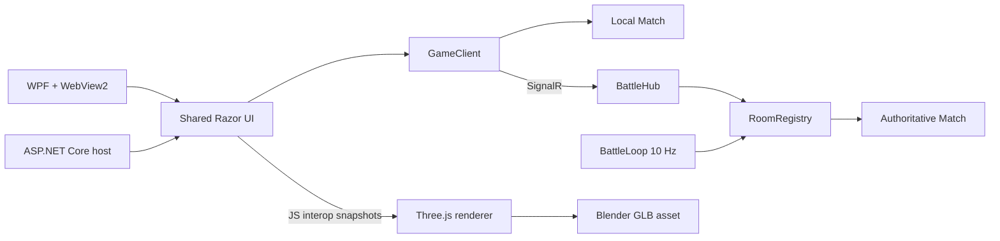

# Architecture / Arsitektur

## Implemented boundaries / Batas modul

`Core` contains deterministic rules and immutable snapshot records, with no UI or networking dependencies. `UI` owns reusable Razor views, a scoped client, options, and JavaScript rendering. `Server` owns room membership, command validation, command-rate limits, and the multiplayer tick. `Desktop` supplies WPF/WebView2 and dependency injection.

`Core` memuat aturan deterministik tanpa dependensi UI/jaringan. `UI` dipakai kedua host. `Server` mengelola identitas koneksi, ruang, validasi perintah, dan tick bersama. `Desktop` menyediakan WPF/WebView2 serta dependency injection.

## Simulation and ownership / Simulasi

Each match advances by exactly 100 ms. A local match uses a semaphore; shared rooms use a registry lock. Network commands derive the player owner from the connection, never from a client-supplied owner ID. Coordinates must be finite and are clamped to arena bounds. Costs, mode restrictions, cooldowns, room capacity, and command rate are checked by the simulation/server.

Setiap tick tetap 100 ms. Owner pemain berasal dari koneksi server. Koordinat, biaya, mode, cooldown, kapasitas, dan laju perintah divalidasi sebelum diterapkan. Snapshot 10 Hz dikirim ke setiap pemain; renderer menginterpolasi posisi. HTTP `/health` memeriksa kehidupan proses, bukan kualitas gameplay.

The current loop deliberately uses simple O(n²) nearest-target queries with a 100-unit cap. Snapshots allocate arrays per tick; terrain uses shared/instanced geometry. The renderer disposes GPU objects, observers, input handlers, audio, and its animation loop on teardown. There is no measured claim of AAA performance, fixed 60 FPS, or 128-player capacity.

## RTS navigation and orders / Navigasi dan perintah RTS

`NavigationMap` uses a deterministic visibility graph around three expanded rectangular ruins. Dijkstra selects a route; movement reuses waypoints and checks every step against the same collision bounds. Clear paths bypass graph allocation. Combat checks line of sight against physical ruin bounds. The renderer reuses the Blender shrine asset for ruins and the snapshot supplies their shared geometry bounds.

`NavigationMap` menggunakan graf visibilitas deterministik di sekitar tiga reruntuhan persegi. Dijkstra menentukan rute; waypoint digunakan ulang dan setiap langkah diperiksa. Jalur langsung tidak membentuk graf. Pertempuran memeriksa garis tembak. Renderer memakai ulang aset candi Blender dengan batas rintangan dari snapshot.

RTS commands include at most 24 unique unit IDs. The server verifies mode, live ownership, destination and all paths before applying the group order. Formation slots are sorted by unit ID for deterministic results. Move never chases; attack-move engages nearby enemies and resumes its destination; hold stops travel but permits attacks in range. The client receives explicit acceptance/rejection. Selection itself is local UI state.

Perintah RTS memuat maksimal 24 ID unik. Mode, unit hidup, kepemilikan, tujuan, serta semua rute diperiksa sebelum perintah kelompok diterapkan. Formasi memakai urutan ID tetap. Bergerak tidak mengejar; serang-bergerak mengejar musuh dekat lalu melanjutkan tujuan; tahan posisi tetap bisa menyerang dalam jangkauan. Seleksi hanya status UI lokal.

This does not implement unit avoidance, dynamic building collision, navigation meshes, or network protocol backward compatibility. / Belum ada penghindaran antarunit, collision bangunan dinamis, navmesh, atau kompatibilitas protokol versi lama.

## MOBA rules / Aturan MOBA

MOBA reuses the same `Match` loop with extra unit kinds. `tower` is stationary and attacks at range 14. `champion` is an AI hero from `Catalog.AllyChampions`/`EnemyChampions` that follows a lane like a minion and retreats to its base below 30% health until above 80%. The team-3 `boss` is stationary and is targeted only by player heroes. `BaseExposed(team)` gates all base damage on that team having lost a tower. Heroes and champions that die in MOBA move from `units` to a pending list and are re-added after 100 ticks with the same ID, so client lookups stay valid; defeat by hero loss applies only to the other modes. `BuyItem` is handled before the living-hero check so it works while dead. Item levels are packed two bits per item in `MatchView.Items`; `Respawn` and `Buff` are seconds remaining. Every unit records the team of its last attacker, which decides whether a boss kill grants the blessing.

MOBA memakai loop `Match` yang sama dengan jenis unit tambahan. `tower` diam dan menyerang pada jangkauan 14. `champion` adalah hero AI dari `Catalog.AllyChampions`/`EnemyChampions` yang mengikuti jalur seperti pasukan dan mundur ke candinya di bawah 30% HP sampai di atas 80%. `boss` tim 3 diam dan hanya menjadi sasaran hero pemain. `BaseExposed(team)` mensyaratkan tim itu sudah kehilangan satu menara sebelum candinya dapat dirusak. Hero dan champion yang gugur di MOBA dipindahkan dari `units` ke daftar tunggu dan ditambahkan lagi setelah 100 tick dengan ID yang sama, sehingga pencarian di klien tetap valid; kekalahan karena hero gugur hanya berlaku pada mode lain. `BuyItem` diproses sebelum pemeriksaan hero hidup agar bisa dipakai saat gugur. Level item dikemas dua bit per item pada `MatchView.Items`; `Respawn` dan `Buff` adalah sisa detik. Setiap unit mencatat tim penyerang terakhirnya, yang menentukan apakah tumbangnya boss memberi restu.

## Selection and control groups / Seleksi dan grup kontrol

Selection never reaches the simulation, so box selection and control groups add no commands and leave the snapshot unchanged. The renderer defers RTS left-button presses until release: under 8 px of movement it is a click; beyond that it projects each owned unit's rendered position to the screen and sends the enclosed IDs to `GameShell.SelectUnits`. Touch input keeps the immediate click path. `TacticalGroups` holds three slots (4–6) per match. `Filter` is the single rule for both features: RTS mode, own living hero/soldier/worker, distinct, sorted by ID, capped at 24. Groups are pruned against every snapshot, so a recalled group can only contain units the server would accept in an order.

Seleksi tidak pernah masuk ke simulasi, sehingga seleksi kotak dan grup kontrol tidak menambah perintah dan tidak mengubah snapshot. Renderer menunda penekanan tombol kiri RTS sampai dilepas: di bawah 8 px dianggap klik; selebihnya posisi tampil setiap unit milik pemain diproyeksikan ke layar dan ID di dalam kotak dikirim ke `GameShell.SelectUnits`. Input sentuh tetap memakai jalur klik langsung. `TacticalGroups` menyimpan tiga slot (4–6) per pertandingan. `Filter` menjadi satu aturan untuk kedua fitur: mode RTS, hero/prajurit/pekerja hidup milik sendiri, unik, terurut ID, maksimal 24. Grup dibersihkan pada setiap snapshot, sehingga grup yang dipanggil hanya berisi unit yang akan diterima server.

## Fog of war / Kabut perang

Fog is applied where snapshots are built, not in the client. In RTS, `Match.Snapshot(owner)` computes the team's vision circles (shrine plus every living allied unit and building, radius by kind) and omits team-1 units outside all of them. The circles travel in `MatchView.Vision` so both renderers draw exactly what the server used. `Snapshot(fog: false)` returns the unfiltered view for tests and future spectators; `RoomRegistry` and `GameClient` never request it. Vision is distance-only and shared by both players. The simulation itself is unchanged: AI targeting, combat and placement rules do not consult fog. The Three.js renderer paints the circles into a 128×128 canvas texture on a ground overlay and keeps a second canvas of explored ground, reset when the tick counter restarts. Other modes send an empty `Vision` and draw no fog.

Kabut diterapkan saat snapshot dibuat, bukan di klien. Pada RTS, `Match.Snapshot(owner)` menghitung lingkaran pandang tim (candi serta semua unit dan bangunan sekutu yang hidup, radius menurut jenis) dan tidak menyertakan unit tim 1 di luar semuanya. Lingkaran dikirim melalui `MatchView.Vision` sehingga kedua renderer menggambar persis yang dipakai server. `Snapshot(fog: false)` memberi tampilan tanpa saringan untuk tes dan penonton kelak; `RoomRegistry` dan `GameClient` tidak pernah memintanya. Pandangan hanya berdasarkan jarak dan dibagi kedua pemain. Simulasi tidak berubah: penargetan AI, pertempuran, dan aturan penempatan tidak memeriksa kabut. Renderer Three.js melukis lingkaran ke tekstur kanvas 128×128 pada lapisan tanah dan menyimpan kanvas kedua untuk wilayah terjelajah, yang direset saat hitungan tick mulai ulang. Mode lain mengirim `Vision` kosong dan tidak menggambar kabut.

## Worker economy / Ekonomi pekerja

Workers have a 20-gold cargo limit and a 20-tick extraction cycle. Resource balances are decremented on pickup, not on arrival; shared-room serialization prevents double harvesting. Depositing credits the shared treasury and `GoldCollected`. Return-cargo clears the resource target and idles after delivery. Movement/hold interrupt extraction while preserving cargo; death discards it and refunds supply. Each tick chooses the nearest living depot so destruction does not retain stale building references.

Muatan pekerja maksimal 20 emas dengan siklus pengambilan 20 tick. Saldo tambang berkurang ketika diambil; serialisasi ruang mencegah panen ganda. Penyetoran menambah kas dan `GoldCollected`. Perintah setor menghapus target tambang dan berhenti setelah tiba. Bergerak/tahan menyimpan muatan, kematian membuangnya dan mengembalikan suplai. Depot hidup terdekat dicari setiap tick.

Outpost placement validates finite coordinates, map bounds, a 55-unit build radius, shrine exclusion, ruin footprint clearance, resource spacing, unit occupancy, reserved spawn points and the four-building limit before charging. Foundations immediately reserve the footprint; workers complete them in 80 working ticks. Construct commands validate owned workers and owned unfinished targets before applying any orders. Progress advances at most once per site per tick, irrespective of builder count. Foundations start at 44 HP, gaining 176 HP over construction while retaining damage. Incomplete sites cannot accept deposits. Each match rebuilds its immutable navigation graph on outpost creation/destruction and invalidates cached routes. A 6×6 footprint uses two units of walking clearance. Depots and attackers approach reachable faces; low outposts do not block ranged attacks. Static ruin snapshots remain separate from buildings rendered through unit snapshots. Income is a baseline 3 gold/second plus delivered cargo and combat rewards.

Penempatan pos memeriksa koordinat, batas arena, radius 55, area candi, reruntuhan, tambang, okupansi unit, titik muncul dan batas empat bangunan sebelum biaya dipotong. Fondasi langsung menempati tapak; pekerja menyelesaikannya dalam 80 tick kerja. Perintah Construct memvalidasi kepemilikan pekerja dan target belum selesai sebelum menerapkan perintah. Progres maksimal satu langkah per lokasi per tick, berapa pun jumlah pekerja. Fondasi mulai dengan 44 HP dan bertambah 176 HP selama konstruksi tanpa menghapus kerusakan. Fondasi belum menerima setoran. Graf navigasi setiap match diperbarui saat pos dibangun/hancur dan cache jalur dihapus. Tapak 6×6 memakai jarak aman dua unit. Pekerja dan penyerang mendekati sisi yang terjangkau; pos rendah tidak menghalangi serangan jarak jauh. Snapshot reruntuhan tetap terpisah dari bangunan pada snapshot unit. Pendapatan berasal dari dasar 3 emas/detik, setoran, serta hadiah pertempuran.

Construction continuation scans owned live unfinished sites in stable creation order, skipping those with an active living builder. It runs after completion or loss of the current target, never from the generic hold state. Cancellation is an owner-validated command: refund `75 * remainingTicks / 80` using integer division, remove the foundation immediately, rebuild navigation, and retarget its active builders. Repeated cancellation cannot refund twice because the target no longer exists. Enemy destruction has no refund.

Kelanjutan konstruksi memeriksa fondasi hidup milik pemain dalam urutan penempatan, melewati lokasi dengan pekerja aktif yang masih hidup. Ini berjalan setelah target selesai atau hilang, bukan saat pekerja sekadar diam. Pembatalan memvalidasi pemilik: kembalikan `75 * sisaTick / 80` dengan pembagian integer, hapus fondasi, perbarui navigasi, lalu alihkan pekerja aktifnya. Pembatalan berulang tidak bisa menggandakan emas karena target sudah dihapus. Kehancuran oleh musuh tidak mengembalikan biaya.

Queue order is a per-site priority: placement order by default (the site's ID), or a decreasing counter once the owner issues `PrioritizeConstruction`, which therefore moves the site ahead of every earlier one. The command is rejected for foreign, finished, unknown or already-first targets and never reassigns active builders. `UnitView.Queue` is the 1-based position among the owner's unfinished sites, 0 otherwise.

Urutan antrean adalah prioritas per lokasi: urutan penempatan secara bawaan (ID lokasi), atau penghitung menurun setelah pemilik mengirim `PrioritizeConstruction`, sehingga lokasi itu mendahului semua yang lebih awal. Perintah ditolak untuk target milik pemain lain, yang sudah selesai, tidak dikenal, atau sudah pertama, dan tidak pernah memindahkan pekerja aktif. `UnitView.Queue` adalah posisi berbasis 1 di antara fondasi pemilik yang belum selesai, selain itu 0.

## Version 0.10 rules / Aturan versi 0.10

**Abilities and MOBA growth.** `Guard` heals 20% of maximum HP and halves damage for 40 ticks, with a 12-second cooldown per owner. All damage goes through one `Hit` helper, which also honours invulnerability. In MOBA a hero earns 20/60/100 experience for an enemy troop, champion or tower that dies within 25 units; a level costs `level * 100`, the cap is 6, and each level adds 25 HP and 4 damage. AI champions grow every 600 ticks, at most eight times. Towers prefer non-hero targets. The neutral boss targets only heroes and "hunter" champions; the team that lands the last hit gets the blessing (`MatchView.Buff` / `EnemyBuff`).

**Kemampuan dan pertumbuhan MOBA.** `Guard` memulihkan 20% HP maksimum dan memaruh kerusakan selama 40 tick, dengan jeda 12 detik per pemilik. Semua kerusakan melewati satu fungsi `Hit`, yang juga menghormati kekebalan. Pada MOBA, hero memperoleh 20/60/100 pengalaman untuk pasukan, champion, atau menara musuh yang tumbang dalam jarak 25; satu level memerlukan `level * 100`, batasnya 6, dan tiap level menambah 25 HP dan 4 serangan. Champion AI bertumbuh setiap 600 tick, paling banyak delapan kali. Menara mendahulukan target non-hero. Boss netral hanya membidik hero dan champion "pemburu"; tim yang memberi pukulan terakhir memperoleh restu (`MatchView.Buff` / `EnemyBuff`).

**Fog.** Vision now requires a clear segment past the fixed ruins. AI units acquire targets only within their own sight radius, and in RTS only with line of sight. Explored ground is a 50×50 grid of 2-unit cells updated every five ticks; `CanPlaceOutpost` rejects unexplored cells.

**Kabut.** Pandangan kini memerlukan segmen yang tidak terhalang reruntuhan tetap. Unit AI hanya membidik dalam radius pandangnya sendiri, dan pada RTS hanya dengan garis pandang. Wilayah terjelajah adalah grid 50×50 dengan sel 2 satuan yang diperbarui tiap lima tick; `CanPlaceOutpost` menolak sel yang belum dijelajahi.

**Adventure.** `Story.cs` holds the authored quest graph and dialogue; `Match.Adventure.cs` holds the rules. Quests are listed so that prerequisites come first, which lets one pass per tick resolve the graph. The cave door is an obstacle: Adventure uses `NavigationMap.AdventureClosed` until the guardians fall and `AdventureOpen` afterwards. The boss is invulnerable until its quest becomes active. Victory is completion of the last quest. The snapshot carries `Quests` and `Dialogue` (`"key:line"`); the client resolves text from `Story`, so no story text crosses the wire.

**Adventure.** `Story.cs` memuat graf misi dan dialog; `Match.Adventure.cs` memuat aturannya. Misi diurutkan sehingga prasyarat selalu lebih dahulu, sehingga satu lintasan per tick cukup untuk menyelesaikan graf. Pintu gua adalah rintangan: Adventure memakai `NavigationMap.AdventureClosed` sampai para penjaga tumbang, lalu `AdventureOpen`. Boss kebal sampai misinya aktif. Kemenangan adalah selesainya misi terakhir. Snapshot memuat `Quests` dan `Dialogue` (`"kunci:baris"`); klien mengambil teks dari `Story`, sehingga teks cerita tidak dikirim lewat jaringan.

**Save/load.** `Match.Save()` returns JSON only for a solo Adventure in progress. `Match.Load` treats the input as untrusted: it limits the length, checks the version, hero, unit kinds, coordinates, health ranges, quest IDs and prerequisite order, and returns null on any violation. The browser keeps one save in `localStorage` and refuses anything over 12,000 characters, because on the Blazor Server host the save travels back over the UI circuit, whose message limit is 32 KB. The game hub keeps its own 4 KB limit.

**Simpan/muat.** `Match.Save()` mengembalikan JSON hanya untuk Adventure solo yang sedang berjalan. `Match.Load` memperlakukan masukan sebagai tidak tepercaya: membatasi panjang, memeriksa versi, hero, jenis unit, koordinat, rentang HP, ID misi dan urutan prasyarat, dan mengembalikan null bila ada pelanggaran. Browser menyimpan satu simpanan di `localStorage` dan menolak yang melebihi 12.000 karakter, karena pada host Blazor Server simpanan dikirim kembali lewat sirkuit UI yang batas pesannya 32 KB. Hub permainan tetap memakai batas 4 KB.

**Rooms.** Joining returns a random seat token. An unexpected disconnect keeps the seat for 600 ticks; `Rejoin(code, token)` reattaches a new connection to it. `Leave`, or an expired seat, calls `Match.RemovePlayer`, which removes the hero, hands remaining units to the other player and, in MOBA, restores an AI ally. A room with no connected players for 600 ticks is closed. `Watch(code)` adds one of up to eight spectators, which receive the allied team's snapshot with owner -1 and whose commands are rejected. The client retries `Rejoin` up to ten times, two seconds apart, and stops early if the server answers that the seat is gone.

**Ruang.** Bergabung mengembalikan token kursi acak. Putus koneksi tak terduga menahan kursi selama 600 tick; `Rejoin(kode, token)` memasangkan koneksi baru ke kursi itu. `Leave`, atau kursi yang kedaluwarsa, memanggil `Match.RemovePlayer`, yang menghapus hero, menyerahkan unit tersisa kepada pemain lain dan, pada MOBA, mengembalikan sekutu AI. Ruang tanpa pemain terhubung selama 600 tick ditutup. `Watch(kode)` menambah satu dari maksimal delapan penonton, yang menerima snapshot tim sekutu dengan pemilik -1 dan perintahnya ditolak. Klien mencoba `Rejoin` hingga sepuluh kali dengan jeda dua detik, dan berhenti lebih awal bila server menjawab bahwa kursinya sudah hilang.

Budgets and measurements are in [PERFORMANCE.md](PERFORMANCE.md). / Anggaran dan pengukuran ada di [PERFORMANCE.md](PERFORMANCE.md).

## Version 0.11 platform / Platform versi 0.11

Everything below lives in `src/BattleNusantara.Server/Platform/`; `ServerHost.Build` wires it, and `Program.cs` only starts it or runs `backup`/`restore`. Configuration and operations are in [OPERATIONS.md](OPERATIONS.md).

Semua hal berikut berada di `src/BattleNusantara.Server/Platform/`; `ServerHost.Build` merangkainya, dan `Program.cs` hanya menjalankannya atau perintah `backup`/`restore`. Konfigurasi dan operasional ada di [OPERATIONS.md](OPERATIONS.md).

**Storage.** `IAccountStore` has one implementation, `SqlAccountStore`, written against `DbConnection` with SQL that SQLite and PostgreSQL both accept (TEXT and BIGINT columns, named parameters, `ON CONFLICT`, `LIMIT`, Unix-second times). Only the connection factory differs. Migrations are an ordered list applied in a transaction and recorded in `schema_version`; a database newer than the server is refused. The PostgreSQL factory has never been run.

**Penyimpanan.** `IAccountStore` memiliki satu implementasi, `SqlAccountStore`, yang ditulis terhadap `DbConnection` dengan SQL yang diterima SQLite dan PostgreSQL (kolom TEXT dan BIGINT, parameter bernama, `ON CONFLICT`, `LIMIT`, waktu dalam detik Unix). Hanya pabrik koneksinya yang berbeda. Migrasi adalah daftar berurutan yang diterapkan dalam transaksi dan dicatat di `schema_version`; basis data yang lebih baru daripada server ditolak. Pabrik PostgreSQL belum pernah dijalankan.

**Identity.** `AccountService` validates names and passwords, hashes with PBKDF2, and issues random session tokens whose SHA-256 is stored. `SessionAuthHandler` turns a bearer token (or `access_token` on hub requests) into a principal. `BattleHub` reads the account from `Context.User` and passes it to `RoomRegistry.Enter`; no client argument carries identity. Guests have a null account and are never written to results.

**Identitas.** `AccountService` memvalidasi nama dan kata sandi, melakukan hash PBKDF2, dan menerbitkan token sesi acak yang SHA-256-nya disimpan. `SessionAuthHandler` mengubah bearer token (atau `access_token` pada permintaan hub) menjadi principal. `BattleHub` membaca akun dari `Context.User` dan meneruskannya ke `RoomRegistry.Enter`; tidak ada argumen klien yang membawa identitas. Tamu memiliki akun null dan tidak pernah ditulis ke hasil.

**Results.** When a room's match leaves `Playing`, the registry queues one `FinishedMatch` holding the room ID and the signed-in seats. `BattleLoop` drains that queue after each tick and stores it; the room ID is the primary key, so a repeat is ignored.

**Hasil.** Saat pertandingan sebuah ruang meninggalkan status `Playing`, registry mengantrekan satu `FinishedMatch` berisi ID ruang dan kursi yang sudah masuk. `BattleLoop` mengosongkan antrean itu setelah tiap tick lalu menyimpannya; ID ruang adalah kunci utama, sehingga pengulangan diabaikan.

**Matchmaking.** `Matchmaker` holds the rules and returns the notices to deliver, which keeps it testable without a network. `LobbyGrain` (Orleans, key 0, one silo in the server process) calls it and delivers the notices through the hub, so every decision is serialized. Tickets live in `IQueueStore`: in memory by default, or Redis (never run). On disconnect the hub cancels the ticket before releasing the seat. Rooms themselves are still owned by `RoomRegistry` under its lock, not by grains.

**Matchmaking.** `Matchmaker` memuat aturan dan mengembalikan pemberitahuan yang harus dikirim, sehingga dapat diuji tanpa jaringan. `LobbyGrain` (Orleans, kunci 0, satu silo di proses server) memanggilnya dan mengirim pemberitahuan lewat hub, sehingga setiap keputusan berurutan. Tiket berada di `IQueueStore`: di memori secara bawaan, atau Redis (belum pernah dijalankan). Saat koneksi putus, hub membatalkan tiket sebelum melepas kursi. Ruang sendiri masih dimiliki `RoomRegistry` dengan kuncinya, belum oleh grain.

**Players.** `Match.MaxPlayers` is 10 and `Match.Capacity(mode)` is 5 for MOBA, where each human replaces an AI ally. Owners 0 and 1 keep their original arrival points; later owners line up in two rows south of them.

**Pemain.** `Match.MaxPlayers` bernilai 10 dan `Match.Capacity(mode)` bernilai 5 untuk MOBA, tempat tiap pemain menggantikan satu sekutu AI. Pemilik 0 dan 1 mempertahankan titik kedatangan semula; pemilik berikutnya berbaris dalam dua baris di selatannya.

## Version 0.12 world / Dunia versi 0.12

Everything in this section is presentation. None of it is in `Match`, and none of it changes a snapshot.

Semua hal pada bagian ini adalah tampilan. Tidak ada yang berada di `Match`, dan tidak ada yang mengubah snapshot.

**Sky.** `Atmosphere.At(tick)` (UI project) is a pure function: a day of 3,600 ticks (daylight 0.25 at midnight to 1 at noon; the match starts in the morning) and a weather spell every 450 ticks from the pattern clear, clear, mist, clear, rain, storm, clear. Seven spells against an eight-spell day make the weather drift through the day. `GameShell` passes the result to `world.js` with each snapshot and shows it in the HUD; the renderer eases towards it. Because it depends on the tick alone, clients of one room agree without a protocol change. It must stay cosmetic: fog of war, vision and movement never read it.

**Langit.** `Atmosphere.At(tick)` (proyek UI) adalah fungsi murni: satu hari 3.600 tick dan satu masa cuaca tiap 450 tick dari pola cerah, cerah, kabut, cerah, hujan, badai, cerah. `GameShell` meneruskan hasilnya ke `world.js` bersama tiap snapshot dan menampilkannya di HUD. Karena hanya bergantung pada tick, klien dalam satu ruang selalu sepakat tanpa perubahan protokol. Langit harus tetap kosmetik: kabut perang, pandangan, dan gerakan tidak pernah membacanya.

**Characters.** `assets/blender/create_warrior.py` builds `models/warrior.glb`: about 400 triangles, 12 bones, rigid skinning, clips Idle, Walk and Attack. At load `world.js` keeps the white Cloth primitive (tinted with the unit colour) and merges skin, brass and steel into one vertex-coloured primitive, so a character is two draw calls plus its ring and health bar. Kinds hero, champion, soldier, boss, warden, guardian and npc use it; other kinds stay primitives. The snapshot has no animation state, so the client infers it: a unit whose position changed walks and faces its direction of travel; otherwise one with an enemy within 9 units attacks and faces it; otherwise it idles. Shared geometry and materials are marked and survive the release of a single unit.

**Karakter.** `assets/blender/create_warrior.py` membuat `models/warrior.glb`: sekitar 400 segitiga, 12 tulang, skinning kaku, klip Idle, Walk, dan Attack. Saat dimuat, `world.js` mempertahankan primitif Cloth putih (diwarnai dengan warna unit) dan menggabungkan kulit, kuningan, dan baja menjadi satu primitif berwarna vertex, sehingga satu karakter berbiaya dua draw call ditambah cincin dan bilah HP. Snapshot tidak membawa status animasi, sehingga klien menebaknya: unit yang posisinya berubah berjalan; unit dengan musuh dalam jarak 9 langkah menyerang; selain itu diam.

**Weather, ocean, audio, camera.** Rain is one `LineSegments` of 1,400 recycled drops (40% on power-saving quality, hidden under reduced motion). The ocean is a 96×96 plane displaced in the vertex shader; the swell rises with the weather. A storm adds one soft flash at a time, never under reduced motion. Audio is synthesized with Web Audio: a pad, rain noise that follows the rain level, a low tense layer and drum hits that follow recent damage seen in snapshots, thunder, and a four-note phrase when a match is decided. The opening cinematic is a five-second orbit from the player's hero up to the play camera; any key or press ends it, and it does not run under reduced motion, when the setting is off, or when joining a match already past tick 30. When a match is over, the camera drifts slowly around the arena.

**Cuaca, laut, audio, kamera.** Hujan berupa satu `LineSegments` berisi 1.400 tetes yang didaur ulang (40% pada kualitas hemat daya, disembunyikan pada mode kurangi animasi). Laut adalah bidang 96×96 yang digeser di vertex shader. Badai menambah satu kilatan lembut, tidak pernah pada mode kurangi animasi. Audio disintesis dengan Web Audio: pad, derau hujan, lapisan tegang dan dentum genderang yang mengikuti kerusakan terbaru, guntur, dan frasa empat nada saat pertandingan diputuskan. Sinematik pembuka adalah orbit lima detik dari hero pemain ke kamera permainan; tombol atau klik apa pun mengakhirinya.

**Keeper voice.** `Story.KeeperTopics` holds three bilingual questions with authored answers. The shell shows them when the Keeper quest is done, no dialogue line is showing and the hero is within 10 units of the Keeper. `GameClient.AskKeeper` calls `GET /api/npc/ask` and falls back to the authored answer on any failure or after 10 seconds; with no server it never leaves the client. On the server `NpcService` returns the authored text unless an `INpcVoice` is registered. `SemanticKernelVoice` (Semantic Kernel, Azure OpenAI chat completion) receives only authored text in its prompt. Bounds: a timeout, `Variants` cached replies per topic and language, a daily call cap, one call per topic at a time, a per-address rate limit, and a filter that rejects replies that are empty, too long or contain links or markup. The reply travels over HTTP for display only: the simulation, the snapshot and saves never contain it, so determinism and the save format are untouched.

**Suara Juru Kunci.** `Story.KeeperTopics` memuat tiga pertanyaan dwibahasa dengan jawaban naskah. Shell menampilkannya bila misi Juru Kunci selesai, tidak ada dialog yang tampil, dan hero berada dalam jarak 10 langkah. `GameClient.AskKeeper` memanggil `GET /api/npc/ask` dan kembali ke jawaban naskah pada kegagalan apa pun atau setelah 10 detik. Di server, `NpcService` mengembalikan teks naskah kecuali ada `INpcVoice`. `SemanticKernelVoice` hanya menerima teks naskah di prompt-nya. Batasannya: timeout, cache per topik dan bahasa, batas panggilan harian, satu panggilan per topik pada satu waktu, batas laju per alamat, dan filter jawaban. Jawaban hanya untuk ditampilkan: simulasi, snapshot, dan simpanan tidak pernah memuatnya.

## Version 0.13 / Versi 0.13

**Weather rule.** `Atmosphere` moved to Core. `SightFactor(tick)` is 0.8 in mist and 0.75 in storm; it multiplies `Sight` (how far units notice enemies, all modes) and RTS vision circles, except the shrine's. It depends on the tick only, so it is deterministic and needs no snapshot field. The 0.12 statement that weather is presentation only no longer holds; darkness still is.

**Aturan cuaca.** `Atmosphere` pindah ke Core. `SightFactor(tick)` bernilai 0,8 saat kabut dan 0,75 saat badai; nilainya mengalikan `Sight` dan lingkar pandang RTS, kecuali milik candi. Karena hanya bergantung pada tick, aturan ini deterministik.

**Ultimates.** `HeroDefinition.Ultimate` selects the rule. Burst (the four original heroes): 140 + 15 × level to enemies within 20 in sight, heal 55, cooldown 18 s. Chain (Satria Bledhek): the nearest visible enemy within 26, then up to five jumps to the nearest unstruck enemy within 12 of the last, each 12% weaker; then 60% faster for 4 s; cooldown 16 s. Leap (Rara Angkasa): moves along a clear line to 2 short of the nearest visible enemy within 30, then 110% power to enemies within 14, each staggered 1.5 s; guard for 4 s; cooldown 18 s. All three still damage an exposed enemy base within 22.

**Ultimate.** `HeroDefinition.Ultimate` memilih aturannya: Burst untuk empat hero awal, Chain untuk Satria Bledhek, Leap untuk Rara Angkasa (angka di atas).

**Models in the snapshot.** `UnitView.Model` names the model of heroes and champions (the hero id), NPCs (`keeper`, `captain`) and bosses (`naga`, `kalatidha`); it is empty for other kinds, which the client maps by kind and team. This is the protocol change of 0.13.

**Side quest.** `Story.PlanSideQuest(seed)` is a pure xorshift choice of kind (fragments or spirits), count (3–4) and distinct spots from twelve open ones. `Match.Seed` comes from the host (random per room or solo match; 0 in tests). Meeting the Captain (within 6) spawns the objectives and queues his dialogue; finishing gives 100 gold and +40 maximum HP. The quest log shows it last, as `nakhoda` until started. Saves are version 2 and keep the seed and two flags; version 1 saves load with the Captain added and the side quest not started.

**Tugas sampingan.** `Story.PlanSideQuest(seed)` memilih jenis, jumlah, dan lokasi secara deterministik dari benih. Simpanan versi 2 menyimpan benih; simpanan versi 1 tetap dapat dimuat.

**NPC conversation.** `Story.Npcs` holds each NPC's name, lore and authored "I don't know"; topics carry keywords. `POST /api/npc/talk` takes `{ npc, text, lang }`: the text is stripped of control characters and limited to 160 characters. Without a model, `Story.MatchTopic` routes by keyword. With a model, the system prompt contains only the persona, that NPC's authored facts and the unknown reply; the player's text is the user message and is described to the model as a question, never an instruction. Replies pass the same filter as topic answers and are cached per question (256 entries). The client falls back to keyword routing on any failure.

**Percakapan NPC.** Teks pemain hanya masuk sebagai pesan pengguna, tidak pernah ke instruksi; tanpa model, pertanyaan diarahkan lewat kata kunci.

**Rendering.** `models/characters.glb` holds 24 variants under one `CharacterRig`; at load the client builds one template per variant (the rig with only that mesh) and clones it per unit with `SkeletonUtils`. The `Fixed` material is shared and uses vertex colours; `Tint` is replaced by one material per unit colour. `naga.glb` and `props.glb` follow the same rules. Clips: a unit that moved walks; one standing beside an enemy attacks; one hurt while idle plays Hit; the player's hero plays Cast when its cooldown jumps; a unit that vanishes in sight at half health or less plays Death and sinks. Cutscenes are lists of shots, each a camera path and a look path over a duration, timed by the wall clock.

**Rendering.** Satu template per varian karakter, dikloning per unit; material `Fixed` dipakai bersama, `Tint` per warna unit. Cutscene adalah daftar shot dengan jalur kamera.

## Production expansion / Perluasan produksi

| Area | Next implementation / Implementasi berikutnya |
| --- | --- |
| Orleans | Lobby grain exists; next: one grain per match and real clustering, replacing the in-process room registry / Grain lobby sudah ada; berikutnya grain per match dan clustering nyata |
| PostgreSQL | The store is tested against PostgreSQL 17; next: unlocks and transactional ownership, pooling limits / Store teruji terhadap PostgreSQL 17; berikutnya unlock dan kepemilikan transaksional |
| Redis | The queue store is tested against Garnet; next: Redis itself and several hosts; never the sole source of match truth / Store antrean teruji terhadap Garnet; berikutnya Redis sendiri dan beberapa host |
| Authentication | Accounts and sessions exist; next: HTTPS, password reset, per-account lockout, quotas and moderation / Akun dan sesi sudah ada; berikutnya HTTPS, reset kata sandi, penguncian, kuota |
| Semantic Kernel | Two NPCs with topics and typed questions; next: reviewed reply sets, more NPCs, per-account quotas / Dua NPC; berikutnya kumpulan jawaban yang ditinjau dan kuota per akun |
| Physics/pathfinding | Spatial acceleration and unit avoidance after dynamic outpost routing / Akselerasi spasial dan penghindaran antarunit setelah navigasi pos dinamis |
| Rust | Optional C ABI batch library only after profiling identifies a bottleneck / Library batch C ABI hanya bila profiling membuktikan kebutuhan |
| Rendering | Per-unit models on one rig; next: LODs, instanced skinning above about 100 characters, per-faction rigs / Model per unit; berikutnya LOD dan skinning ber-instance |

Rust is authorized by the repository owner but is not currently needed or included. Preserve deterministic inputs/outputs and safe buffer ownership if adding native interop; benchmark against the C# baseline before accepting complexity.

Rust diizinkan pemilik, tetapi belum diperlukan atau ditambahkan. Jika digunakan nanti, tetapkan ABI, ownership buffer, determinisme, dan benchmark terhadap implementasi C#.

## References / Referensi

- [Microsoft: Blazor Hybrid with WPF](https://learn.microsoft.com/en-us/aspnet/core/blazor/hybrid/tutorials/wpf?view=aspnetcore-10.0)
- [Three.js: WebGLRenderer lifecycle](https://threejs.org/docs/pages/WebGLRenderer)
- [SignalR security patch advisory](https://github.com/advisories/GHSA-334f-vvp4-7g6p): package reference uses 10.0.15; deploy a patched runtime too. Stateful reconnect is not enabled in this prototype.
