# Battle of Nusantara guide

Created by Ariana Mischa Fadhila, Syubadubin Studios.

## Setup

Follow the README commands from the repository root. Install .NET SDK 10, and WebView2 Evergreen Runtime for the Windows desktop application. Browser hosting can run independently of WPF. On Linux and macOS, `src/BattleNusantara.Photino` is the desktop game (it needs WebKitGTK 4.1 on Linux) and the Server project runs as everywhere else; build those two projects rather than the whole solution, whose WPF project is Windows-only. Ready-made Linux and macOS downloads are on the Releases page (see the README). Use a current patched .NET 10 runtime for deployments.

The main menu shows the original Blender shrine of Borobudur Quantum in a valley between a volcano and the sea. Hero selection changes health, damage, colour and ultimate. Every unit is a rigged Blender model.

## Controls and objectives

Click the ground to move your hero. Attacks trigger automatically against nearby enemies. Press **Q** for area damage and healing; the cooldown is 18 seconds. Your allied shrine gradually restores health. **Esc** pauses solo sessions; shared rooms continue running.

In **RTS**, recruit troops for 60 gold/2 supply and workers for 40 gold/1 supply. Place up to four drop-off outposts for 100 gold each. Upgrades cost 140 gold, to a maximum level of four. Destroy the enemy gate before losing your shrine or all heroes.

In **MOBA**, five heroes fight five across three lanes, and minion waves march every 18 seconds. You play one hero; four allies and five opponents are AI. See *MOBA Arena* below.

In **Adventure**, collect all three inscriptions and defeat Sang Kalatidha. Each inscription fully restores your hero's health. Approach guardians separately and retreat to heal when needed. Losing all heroes ends the match. Play again starts a fresh session.

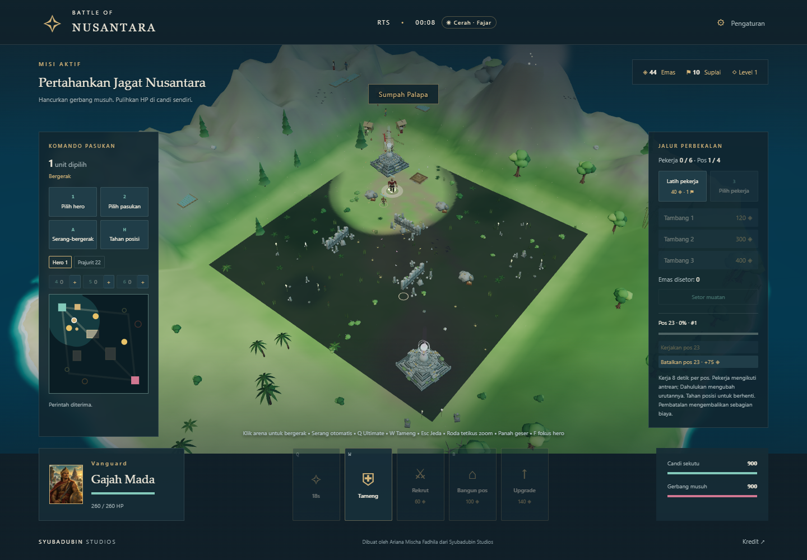

## MOBA Arena

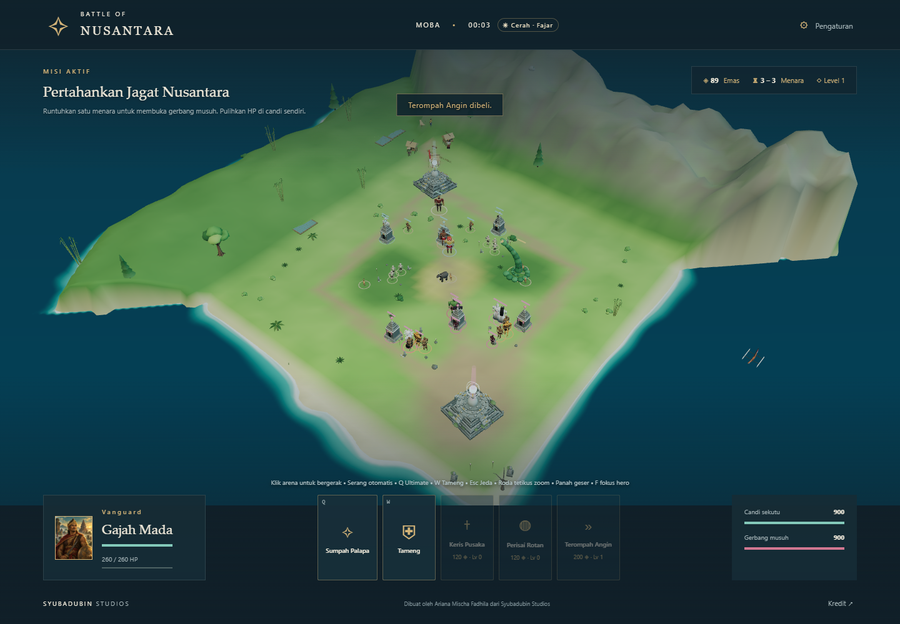

- **Towers.** Each side has one tower per lane. They hit hard at range 14. Your shrine and the enemy gate cannot be damaged while all three of that side's towers stand; destroying any one exposes it. The top bar shows towers remaining as *yours – theirs*.
- **Respawns.** A fallen hero returns at the shrine after 10 seconds with full health. Orders and the ultimate are unavailable meanwhile. You lose only when your shrine falls.
- **Items.** Buy from the bottom bar with shared gold: **Heirloom Keris** (+12 attack), **Rattan Shield** (+90 HP), **Wind Sandals** (+20% speed). Each has three levels; level *n* costs *n* times the base price (120, 120 and 100). Items persist through respawns and can be bought while waiting to return.
- **Naga Basuki.** The neutral boss waits east of the middle lane and attacks only player heroes that come within reach. Lane troops and AI heroes ignore it. If your side lands the final blow you gain 150 gold and a Blessing: +25% attack for your team's heroes for 60 seconds. It returns 90 seconds after falling. Bring items; it out-ranges your hero.
- **Healing.** Standing beside your shrine restores health quickly. AI heroes retreat there when badly hurt.
- **LAN.** A second player replaces one AI ally. Gold is shared; items, cooldowns and respawn timers are per player.

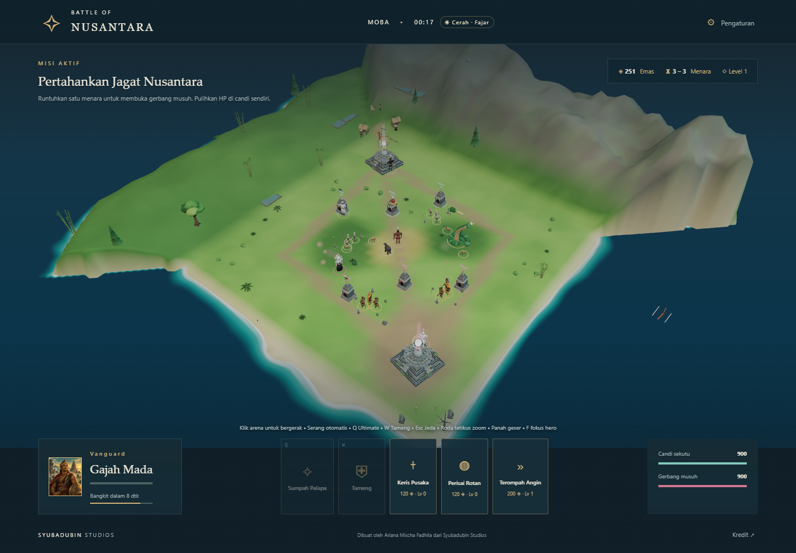

## RTS squad commands

Press **1** for your hero or **2** for your troops (up to 24). Click a unit in the arena to select it; **Shift-click** adds/removes it. The unit roster also supports keyboard and touch. Empty/dead selections fall back to your living hero.

Click ground or the tactical map to move in formation. Units route around three ruins and attack in range without pursuing. Press **A**, then click a destination, for **attack-move**: engage nearby enemies, stop to fight, then resume the destination. **H** holds position while still attacking in range. **Esc** cancels attack targeting before opening pause.

A blocked destination is rejected without replacing the previous order. Attacks and ultimates do not pass through ruins. LAN players can command only their own units; teammate troops are absent from the selectable roster. All clients and the server must use the same release.

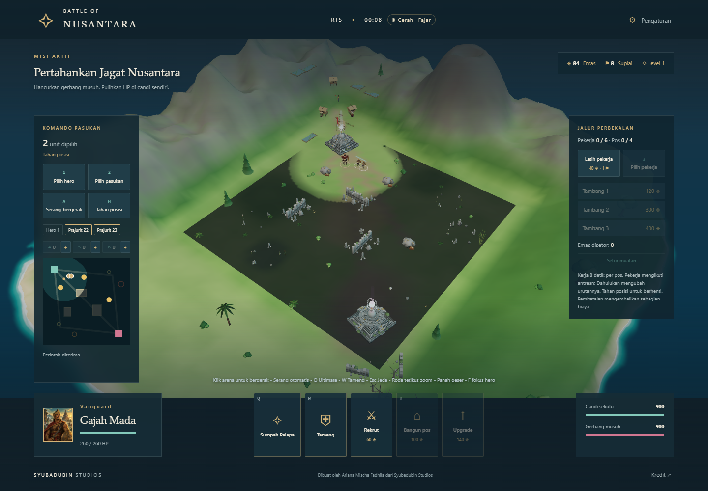

### Box selection and control groups

Hold the left mouse button on the arena and drag to draw a box; releasing selects every unit you own inside it, up to 24. **Shift-drag** adds those units to the current selection. A box with none of your units leaves the selection as it was. A press without dragging is still an ordinary click. Box selection needs a mouse or pen; on touch screens use the unit roster. It is unavailable while choosing an attack-move destination or an outpost location.

**Ctrl+4**, **Ctrl+5** and **Ctrl+6** save the current selection as a group; **4**, **5** and **6** recall it. If your browser uses Ctrl+digit to switch tabs, use **Alt+4–6** or the **+** button beside each group. The panel shows how many living units each group holds. Fallen units leave their groups, and an emptied group is cleared. Groups belong to one match on your device and are not shared with your LAN teammate.

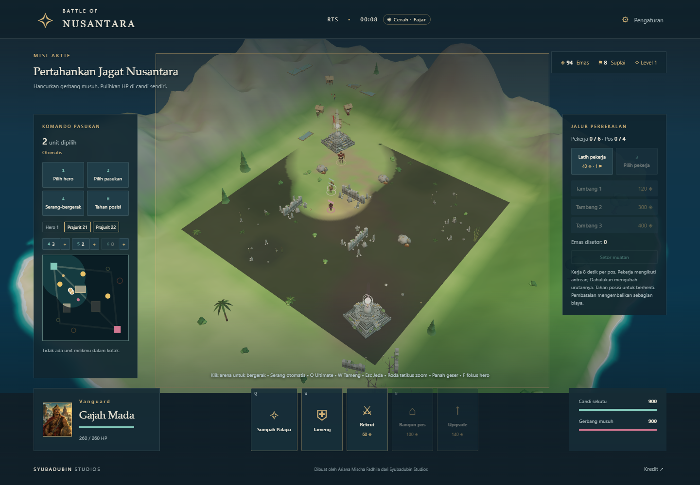

## Fog of war

In RTS Skirmish you see enemies only inside your team's vision. The shrine sees 24 units; a hero 26, a soldier 18, a worker 14, a finished outpost 20 and a foundation 8. Your LAN teammate's units extend the same shared vision. The arena shows unexplored ground dark and ground you have seen before dimmed; the tactical map shades everything outside current vision. Mines, ruins and the enemy gate are always shown.

Hidden enemies are not sent to your client at all. Scout with your hero, keep soldiers forward, or build outposts to watch the approaches. Ruins do not block vision, and the enemy is not limited by fog. MOBA Arena and Adventure have no fog.

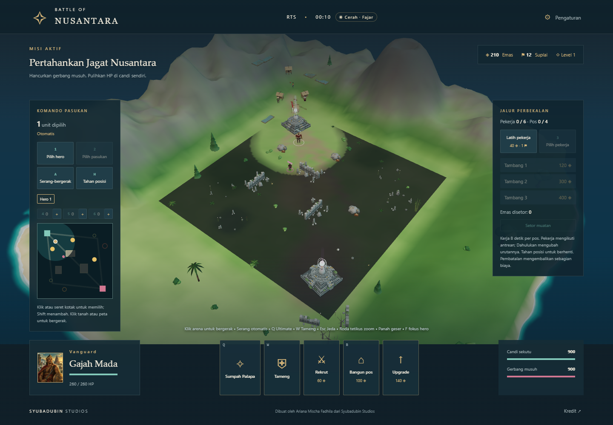

## Workers and drop-off outposts

Click **Train worker** in the supply panel. Each player may have six workers. Press **3** to select your workers, then choose **Mine 1/2/3** in the panel, map, or arena. Workers cannot fight; protect them with troops. Shared mines initially contain 120, 300, and 400 gold.

Workers mine for two seconds, pick up at most 20 gold, deliver to the nearest surviving shrine/outpost, then repeat. Mine balances decrease at pickup; treasury balances increase only at delivery. Workers idle after depletion and final delivery. **H** interrupts work while retaining cargo. **Return cargo** delivers a carried load and then idles. A dead worker loses its cargo and refunds one supply.

Press **B** or **Build outpost**, then click the arena/map. Each outpost costs 100 gold, with a shared limit of four. Sites must be within 55 units of the allied shrine, beyond its 13-unit exclusion radius, and clear of units, other outposts, mines, and ruins. The square previews the footprint; the server validates the final click. Invalid sites never consume gold. **Esc** cancels placement.

Placing a foundation costs 100 gold and starts at 44 HP. The nearest idle owned worker is assigned automatically; otherwise select workers and click **Work on outpost**. Construction needs 80 working ticks (8 seconds), excluding travel, and raises HP toward 220 while retaining combat damage. Several workers do not increase the speed. Move, hold, gather or return-cargo orders interrupt construction; progress and carried gold remain. Reassign owned workers to resume. Enemies can destroy unfinished or finished outposts; enemy destruction gives no refund.

Workers choose another depot if one is destroyed. Outposts no longer generate passive income; baseline income remains 3 gold/second.

Outposts block movement: units route around their footprint and workers deposit from outside. Existing routes update when a post is built or destroyed. New movement orders inside a post are rejected; an older destination covered by construction resolves to its edge. Low outposts do not block ranged attacks. Recruitment and player spawn points remain reserved.

Only completed outposts accept deposits. On completion, cancellation or destruction of their target, active builders continue to the oldest reachable owned unfinished foundation without an assigned living builder. They hold when no work remains. Hold, move, gather and return-cargo orders opt out until explicitly reassigned; placing a new foundation can still assign an idle worker. Newly trained workers need an initial Work on outpost order for existing foundations. Use **Cancel outpost** to remove your unfinished foundation and reopen its footprint. Refund = floor(75 × remaining work ticks / 80); a fresh foundation returns 75 gold and a half-built one returns 37. The button shows the authoritative amount. Completed, destroyed or foreign sites cannot be cancelled. Queue reordering is not available.

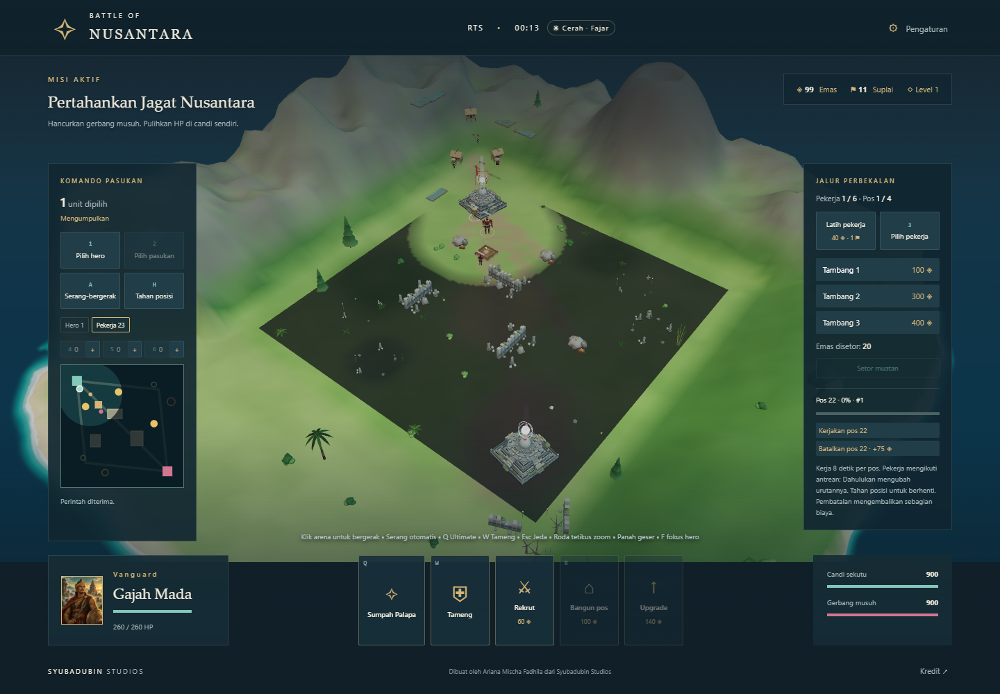

### Queue order

Unfinished foundations show a queue number. Builders that finish a job take the lowest-numbered foundation of yours that nobody is working on. **Prioritize outpost** moves a foundation to **#1**; the rest keep their relative order. It does not interrupt a builder mid-job: use **Work on outpost** for that. Each player has a separate queue.

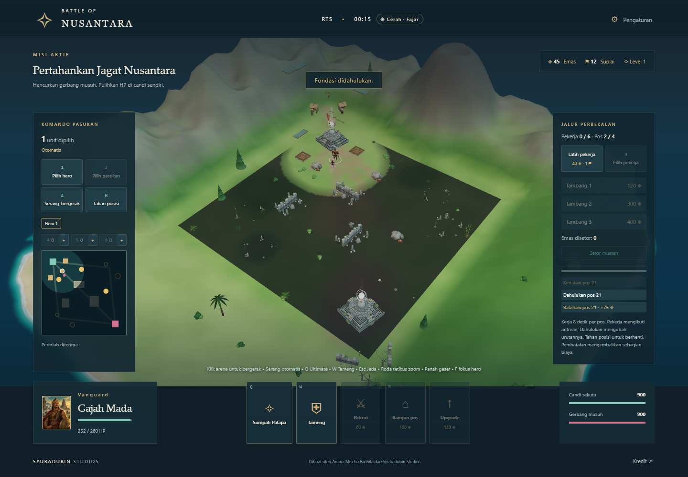

## Two-player LAN

Run the server with `--urls http://0.0.0.0:5080`. Players visit the host's LAN address, for example `http://192.168.1.10:5080`, or launch the desktop client. Open **Begin your adventure → Play together**, enter the reachable server address, and leave the room code empty to create a room. Share the six-character code with the second player.

The room creator chooses the mode. Both players share the economy and objective, but control separate heroes with separate ultimate cooldowns. Browser multiplayer connects from the Blazor host to the specified server; desktop connects directly. Do not enter `0.0.0.0` as a destination.

This is a trusted-LAN prototype. It supports 32 concurrent rooms and up to 100 units per match, with up to ten players (five in MOBA) and eight spectators per room. Room codes work without an account.

## Accounts and matchmaking

Open **Begin your adventure → Account and matchmaking**. Enter an account name (3–20 letters, digits or underscores) and a password of at least 8 characters, then choose **Register**, or **Sign in** if you already have one. The account belongs to the server shown in that section; change the server address under **Play together** first if you play elsewhere. You stay signed in on this device for seven days or until you choose **Sign out**.

Signed in, the section shows your matches played and won and your last three results. Results are recorded when a room match ends, for signed-in players only. Pick a mode and hero, then press **Find a match**: you wait until another signed-in player searches for the same mode, and both of you are placed in a new room. **Cancel search** leaves the queue; a search with no partner closes after two minutes.

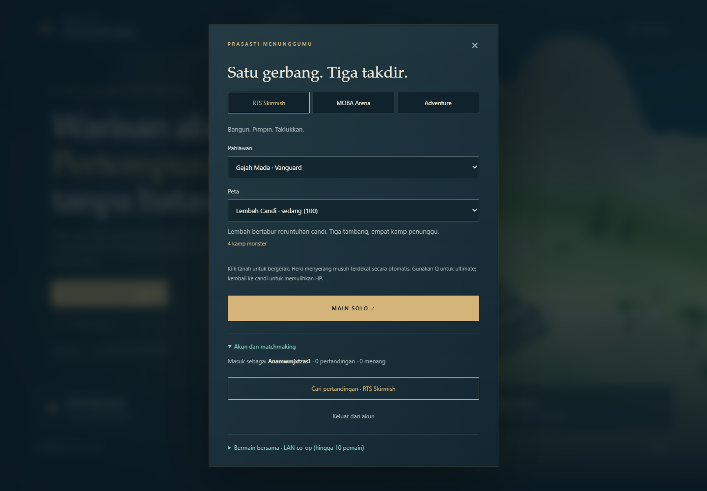

There is no password reset: a forgotten password means a new account. On a plain HTTP server your password is sent unencrypted, so use accounts only on a network you trust.

**Reconnecting.** If your connection drops, the game shows "Reconnecting…" and tries to return you to your seat for about 20 seconds; the server holds the seat for 60 seconds. If that fails, return to the menu and join again with the room code. Choosing **End game** leaves on purpose: your seat is freed at once, your hero is removed, and your soldiers, workers and outposts pass to your teammate. In MOBA an AI ally takes your place. A room with no players for 60 seconds is closed.

**Watching.** Enter a room code and choose **Watch room**. Spectators see what the allied team sees, take no player seat and cannot give orders.

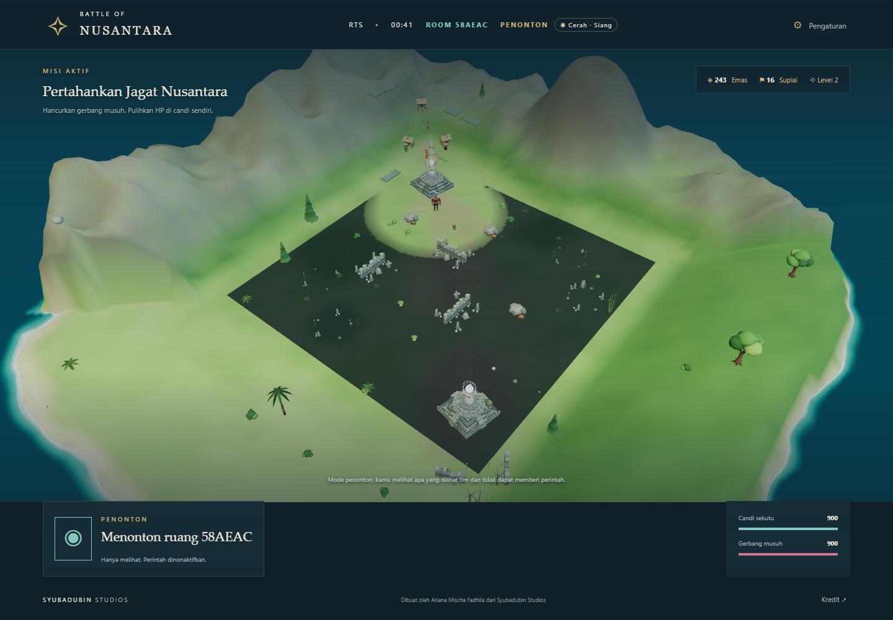

Public matchmaking and internet deployment require additional security work.

## Options and troubleshooting

Language, graphics quality, reduced motion, the opening cinematic, dialogue voices and the sound volume persist in localStorage. Sound starts after the first click or key press. Power-saving mode lowers pixel density, turns off shadows and bloom, draws lighter characters, a quarter of the scattered nature and fewer particles. On a computer without a usable GPU (software rendering) the high setting also runs without bloom and shadows. Hover or focus the credits to pause scrolling; reduced motion enables manual scrolling.

If the arena cannot load, enable WebGL2/GPU acceleration. Run `npm ci` and `npm run vendor` if vendor files are missing. Ensure the GLB exists under `src/BattleNusantara.UI/wwwroot/models/`. For LAN errors, check the host address, firewall port 5080, and room capacity.

The easiest install is the installer from the Releases page. To build it yourself (Inno Setup 6 required) run `./scripts/package.ps1`: it publishes the desktop game and the LAN server self-contained for win-x64 and writes `artifacts/installer/BattleNusantara-<version>-win-x64-setup.exe` with a SHA-256 file. The installer installs per user into `%LOCALAPPDATA%\Programs\Battle of Nusantara` (no administrator rights), so the server can write its account database under `Server\data`; the "LAN server" shortcut listens on `http://0.0.0.0:5080`. WebView2 is still required for the desktop game.

## World, weather and the opening shot

Each match opens with a five-second camera move; press any key or click to skip it, or untick **Opening cinematic** in Settings. The chip beside the match clock shows the weather and the time of day. A day lasts six minutes and the weather changes every 45 seconds: clear, mist, rain or storm. **Mist and storm shorten sight** (to 80% and 75%) for every unit; darkness and rain are visual only. With **Reduce motion** on there is no cinematic, no falling rain and no lightning; the chip still tells you the weather. Sound follows the match: rain and thunder can be heard, and the battle layer of the music rises while units are being hurt.

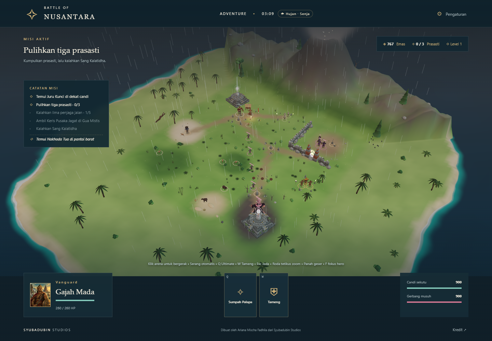

## Asking the Keeper

In Adventure, after you have met the Keeper, stand beside him while no dialogue is showing. A panel offers three questions. The answers are authored. If the server you play on has a language model configured, the answer is worded by the model and tagged **AI reply**; otherwise, or if the model is slow or fails, you see the authored text tagged **scripted**. In the desktop game without a server the answers are always the authored ones. Asking never changes the match.

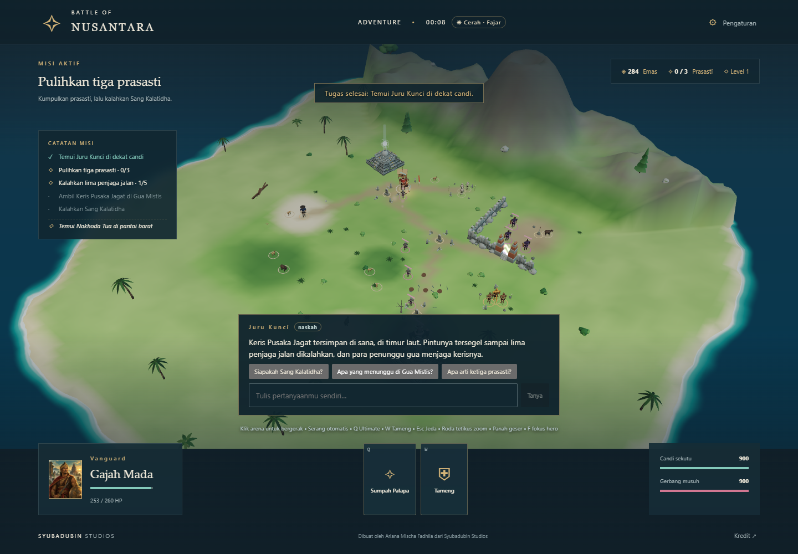

## Heroes and their ultimates

Six heroes are playable. Gajah Mada, Cut Nyak Dien, Nyi Roro Kidul and the Republic Sentinel use a **burst** around themselves that also heals a little. **Satria Bledhek** (Superhero faction) throws lightning at the nearest enemy that jumps to up to five more close by, then runs 60% faster for four seconds. **Rara Angkasa** flies onto the nearest enemy within reach, hits everything around her with a shockwave that staggers it, and takes half damage for four seconds. Both are original heroes made for this game.

## The Old Captain

In Adventure, walk to the western shore to meet the Old Captain. He gives a side quest that changes every game: gather his ship fragments or drive off the sea spirits, three or four of them. Finishing it gives 100 gold and +40 maximum HP; it is optional. Standing beside the Captain or the Keeper, you can pick a question or **type your own** (up to 160 characters). Without a language model on the server, typed questions are answered from the authored text by keyword.

## Sound

Dialogue is voiced in the selected language; untick **Dialogue voices** in Settings to read only. The title screen plays the "Borobudur Quantum" theme. In a match the exploration music plays, and when fighting breaks out its battle layer (taiko, strings, brass and choir) rises over it in time with the music. A stinger marks victory or defeat. You hear the day (wind and birds), the night (crickets and frogs) and the rain, and effects such as blows, ultimates, loot, level-ups, cleared camps, building, mining and the animals come from where they happen on screen. **Sound volume** in Settings sets the overall level.

## Maps

Each mode has its own maps, chosen in the play panel under **Map**; the size is shown beside the name.

| Map | Mode | Size | What sets it apart |
| --- | --- | --- | --- |
| Temple Valley | RTS | medium (100) | Temple ruins, three mines, four camps |
| Southern Shore | RTS | small (80) | A narrow shore between two lagoons; fast, close fighting |
| Forbidden Forest | RTS | large (140) | Groves that block sight, four mines, seven camps including an ancient one |
| Jagat Arena | MOBA | medium (100) | Three lanes, Naga Basuki in the southern jungle, four camps |
| Savanna Ring | MOBA | small (80) | Short lanes, fights start sooner |
| Dragon Bridges | MOBA | large (140) | A river with three bridges and the dragon's ford, seven camps |
| Inscription Isle | Adventure | medium (100) | The story island |

Water blocks walking but not sight; ruins, rocks and groves block both. The tactical map in RTS is drawn to the map's size.

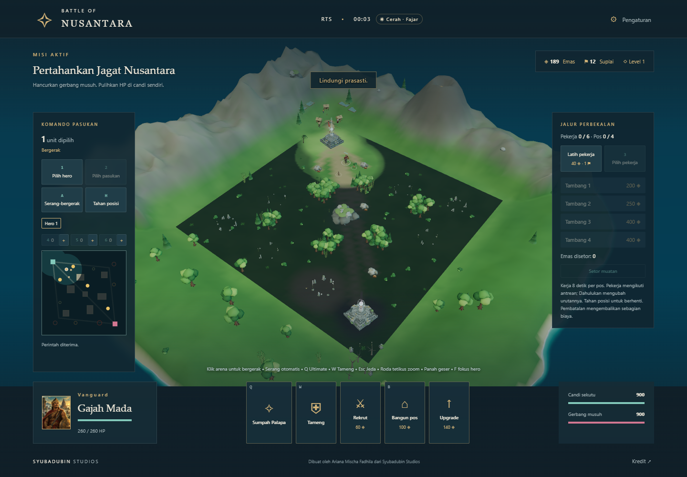

## Camera

Roll the **mouse wheel** to zoom between a close look and the whole map. Pan with the **arrow keys** or by dragging with the **middle mouse button**. **F** centres on your hero; **Home** returns to the whole map.

## Jungle camps and treasure

Camps are marked by torches and a ring of stones, and as rings on the RTS tactical map coloured by tier. **Weak** camps hold three tuyul; **Medium** camps monkey and tiger siluman; **Strong** camps crocodile siluman and a genderuwo; **Ancient** camps Banaspati, a fire spirit, with tiger siluman. Monsters attack your units that come close and call the rest of their camp; they chase only so far and then walk home to heal, so you can pull back and return. Your troops defend themselves but only your hero goes after a camp on its own; enemy armies leave camps alone.

A cleared camp returns after one to four minutes (stronger camps take longer) and drops treasure, marked by a pillar of light in the colour of its rarity. Walk your hero over it to take it for the rest of the match:

| Treasure | Rarity | Effect |
| --- | --- | --- |
| Turmeric Tonic (jamu) | minor | +20 HP and heals 60% |
| Whetstone | minor | +4 attack |
| Sea-Root Bracelet | minor | +40 HP |
| Seven-Wave Keris | major | +10 attack |
| Dragon-Scale Mail | major | +110 HP |
| Lightning Sandals | major | +15% speed |
| Banaspati Gem | legendary | +15 attack, +150 HP, +10% speed, full heal |
| Treasure Chest | treasure | +200 gold |

Weak camps drop a minor item half the time; medium camps a minor one and sometimes a major one; strong camps a major one and sometimes a minor one; ancient camps a legendary item, a major one and the chest. Your finds are listed under your hero's health. In MOBA, monsters also give experience.

## Wildlife and villagers

Animals live in the regions that suit them. The **mouse-deer** runs from anyone. The **water buffalo** grazes and fights back only when hit. The **wild boar** charges anything that comes close and then returns to its patch. In RTS, the **thieving macaque** steals the gold a worker is carrying and runs home with it; defeat it before it has been home for thirty seconds to get the gold back. Animals give a little gold when your side defeats them and come back later. Villagers, chickens, birds, butterflies and fireflies are scenery: they live only on your screen and never take part in the battle.

## Guard

Press **W** or the **Guard** button in any mode. Your hero restores 20% of maximum HP and takes half damage for 4 seconds. The cooldown is 12 seconds and is separate from the ultimate.

## MOBA levels

Your hero gains experience from enemy troops, heroes and towers that fall within 25 units of it, and levels up to 6. Each level adds 25 HP and 4 attack; the thin gold bar under the HP shows progress. AI heroes on both sides grow stronger every minute. Towers shoot troops before heroes, so advance behind your wave. Enemy heroes on the eastern lane may attack Naga Basuki; if they land the last hit, the enemy gets the Blessing, shown in the resource bar.

## Adventure quests

The quest log on the left lists five quests. Meet the Keeper beside the shrine, defeat the five road guardians to unseal the Mystic Cave in the north-east, take the Jagat Heirloom Keris inside (+15 attack), and recover the three inscriptions. Only then does Sang Kalatidha lose his ward. Each quest pays 60 gold. Dialogue appears above the HUD; **Next** skips a line, and lines also advance on their own without pausing play.

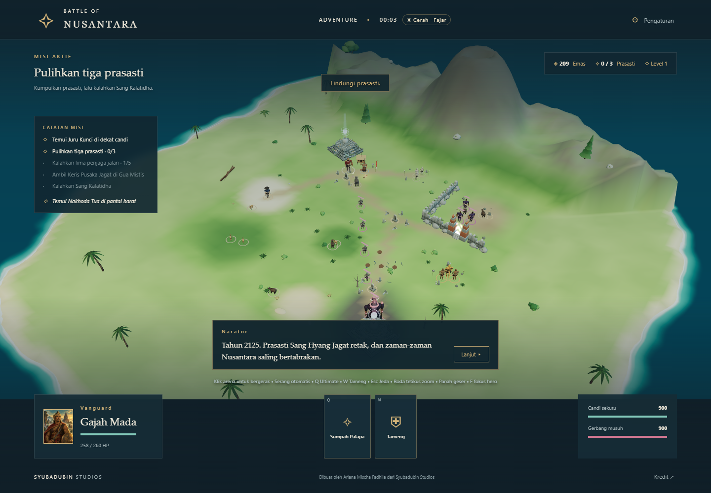

**Saving.** In a solo Adventure, press **Esc** and choose **Save game**. From the main menu, **Begin your adventure → Continue saved Adventure** resumes it with the same hero. There is one save slot, kept in this browser profile or desktop user profile. A damaged save is refused and deleted.

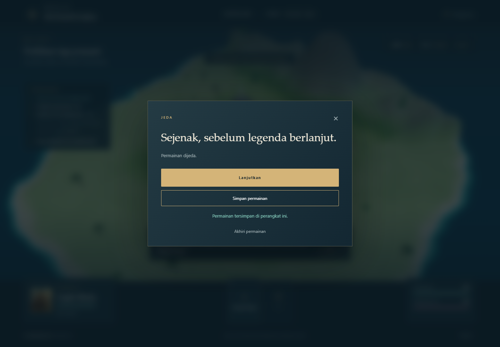

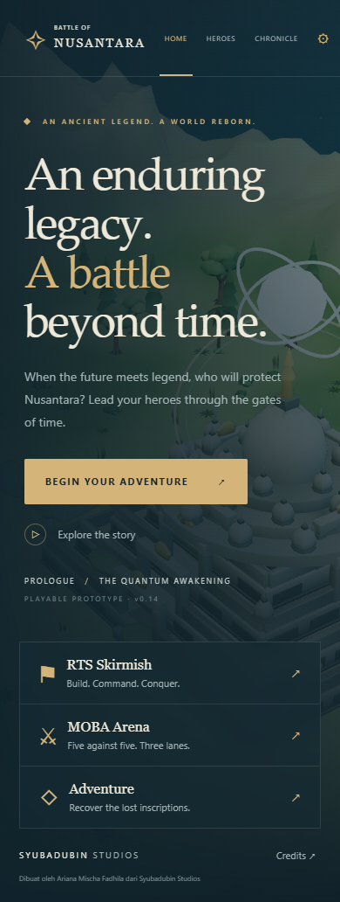
