# Panduan Battle of Nusantara

Dibuat oleh Ariana Mischa Fadhila dari Syubadubin Studios.

## Instalasi dan menjalankan

Gunakan .NET SDK 10 dan jalankan perintah pada README dari direktori repositori. WPF memerlukan Windows dan WebView2 Runtime. Host browser dapat dijalankan terpisah dari desktop. Linux/macOS dapat membangun proyek Server saja, bukan seluruh solusi WPF.

Menu utama menampilkan candi GLB buatan Blender. Pilih **Pahlawan** untuk melihat HP, damage, peran, dan ultimate. Pemilihan hero memengaruhi statistik simulasi; visual unit masih berupa penanda geometris, bukan model karakter final.

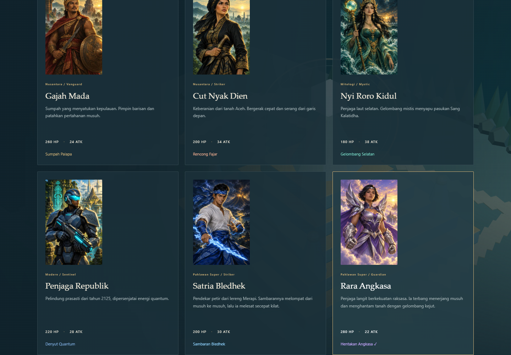

## Kontrol dan tujuan

- Klik tanah dalam arena untuk menentukan tujuan hero. Hero menyerang musuh terdekat secara otomatis.
- Tekan **Q** atau tombol skill untuk damage area dan pemulihan HP. Cooldown 18 detik.
- Mendekati candi sekutu di sudut arena memulihkan HP secara bertahap.
- **RTS:** pasukan seharga 60 emas/2 suplai; pekerja 40 emas/1 suplai; pos penyetoran 100 emas, maksimal empat; upgrade 140 emas, maksimal level empat. Kalahkan gerbang musuh sebelum candi sekutu hancur.
- **MOBA:** lima hero melawan lima di tiga jalur, dengan gelombang pasukan setiap 18 detik. Kamu memainkan satu hero; empat sekutu dan lima lawan dikendalikan AI. Lihat *MOBA Arena* di bawah.
- **Adventure:** sentuh tiga prasasti dan kalahkan Sang Kalatidha. Prasasti memulihkan HP sepenuhnya. Hindari menarik semua penjaga sekaligus.
- Permainan berakhir jika seluruh hero gugur atau candi sekutu hancur. Pilih main lagi untuk memulai sesi baru.
- **Esc:** jeda solo. Ruang LAN tetap berjalan ketika panel terbuka.

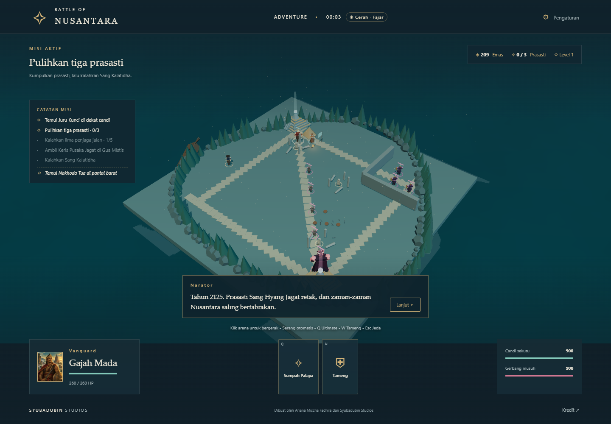

## MOBA Arena

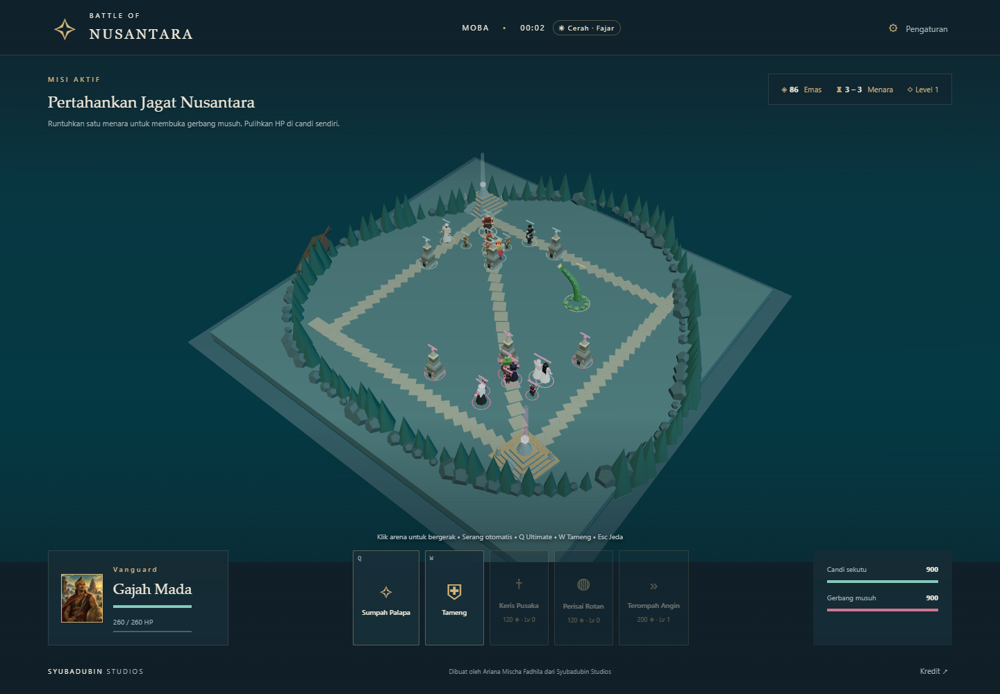

- **Menara.** Setiap sisi memiliki satu menara per jalur dengan serangan kuat pada jangkauan 14. Candimu dan gerbang musuh tidak dapat dirusak selama ketiga menara sisinya masih berdiri; meruntuhkan satu saja sudah membukanya. Bilah atas menampilkan sisa menara sebagai *milikmu – milik lawan*.
- **Bangkit.** Hero yang gugur kembali di candi setelah 10 detik dengan HP penuh. Selama itu perintah dan ultimate tidak tersedia. Kamu kalah hanya bila candi runtuh.
- **Item.** Beli dari bilah bawah memakai emas bersama: **Keris Pusaka** (+12 serangan), **Perisai Rotan** (+90 HP), **Terompah Angin** (+20% kecepatan). Tiap item memiliki tiga level; level *n* berharga *n* kali harga dasar (120, 120, dan 100). Item tetap ada setelah bangkit dan dapat dibeli saat menunggu.
- **Naga Basuki.** Boss netral menunggu di timur jalur tengah dan hanya menyerang hero pemain yang mendekat. Pasukan jalur dan hero AI mengabaikannya. Jika pukulan terakhir berasal dari pihakmu, kamu mendapat 150 emas dan Restu: +25% serangan hero timmu selama 60 detik. Ia muncul kembali 90 detik setelah tumbang. Siapkan item; jangkauannya melebihi hero.
- **Pemulihan.** Berdiri di dekat candi memulihkan HP dengan cepat. Hero AI mundur ke sana saat terluka parah.
- **LAN.** Pemain kedua menggantikan satu sekutu AI. Emas dibagi; item, cooldown, dan waktu bangkit berlaku per pemain.

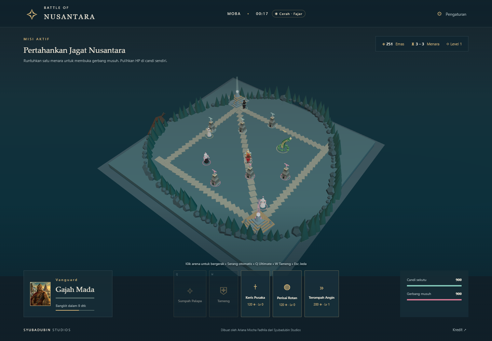

## Komando taktis RTS

Gunakan **1** untuk hero atau **2** untuk semua pasukan milikmu (maksimal 24). Klik unit pada arena untuk memilih satu; **Shift+klik** menambah/mengurangi pilihan. Daftar unit pada panel kiri juga dapat dipakai dengan keyboard atau sentuhan. Bila pilihan kosong atau unit terpilih gugur, pilihan kembali ke hero yang masih hidup.

Klik tanah atau peta taktis untuk bergerak dalam formasi. Unit menghindari tiga reruntuhan dan tetap menyerang musuh dalam jangkauan tanpa mengejarnya. Tekan **A**, lalu klik tujuan untuk **serang-bergerak**: pasukan mengejar lawan dekat, berhenti untuk bertempur, dan melanjutkan tujuan setelah ancaman hilang. **H** menahan posisi sambil tetap menyerang dalam jangkauan. **Esc** membatalkan mode penentuan tujuan serangan; tekan lagi untuk jeda.

Tujuan yang terhalang ditolak dengan pesan pada panel, tanpa mengubah perintah sebelumnya. Serangan dan ultimate tidak menembus reruntuhan. Pemain LAN hanya dapat mengendalikan unit sendiri; panel tidak menampilkan pasukan rekan sebagai pilihan. Gunakan rilis yang sama pada kedua klien dan server.

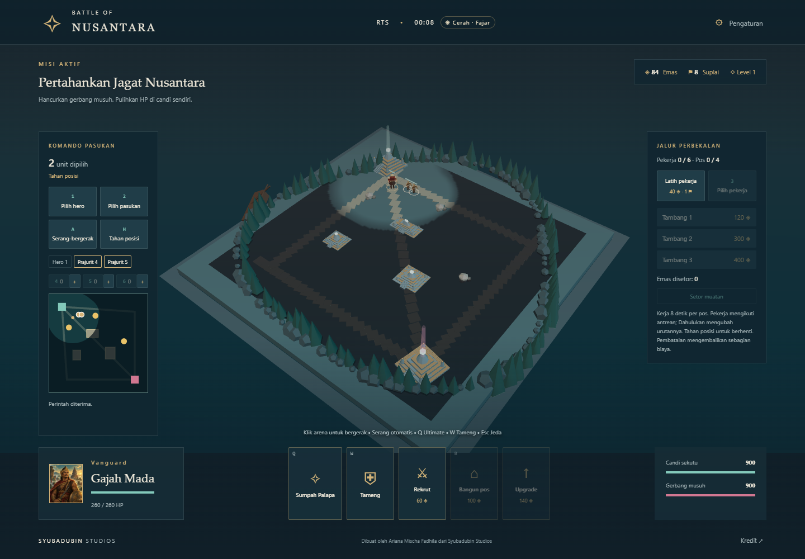

### Seleksi kotak dan grup kontrol

Tahan tombol kiri mouse pada arena lalu seret untuk menggambar kotak; saat dilepas, semua unit milikmu di dalamnya terpilih, maksimal 24. **Shift+seret** menambahkan unit tersebut ke pilihan saat ini. Kotak tanpa unit milikmu tidak mengubah pilihan. Menekan tanpa menyeret tetap dianggap klik biasa. Seleksi kotak memerlukan mouse atau pena; pada layar sentuh gunakan daftar unit. Fitur ini tidak aktif saat memilih tujuan serang-bergerak atau lokasi pos.

**Ctrl+4**, **Ctrl+5**, dan **Ctrl+6** menyimpan pilihan sebagai grup; **4**, **5**, dan **6** memanggilnya. Jika browser memakai Ctrl+angka untuk berpindah tab, gunakan **Alt+4–6** atau tombol **+** di samping tiap grup. Panel menampilkan jumlah unit hidup pada setiap grup. Unit yang gugur dikeluarkan dari grup, dan grup yang kosong dihapus. Grup berlaku untuk satu pertandingan pada perangkatmu dan tidak dibagikan kepada rekan LAN.

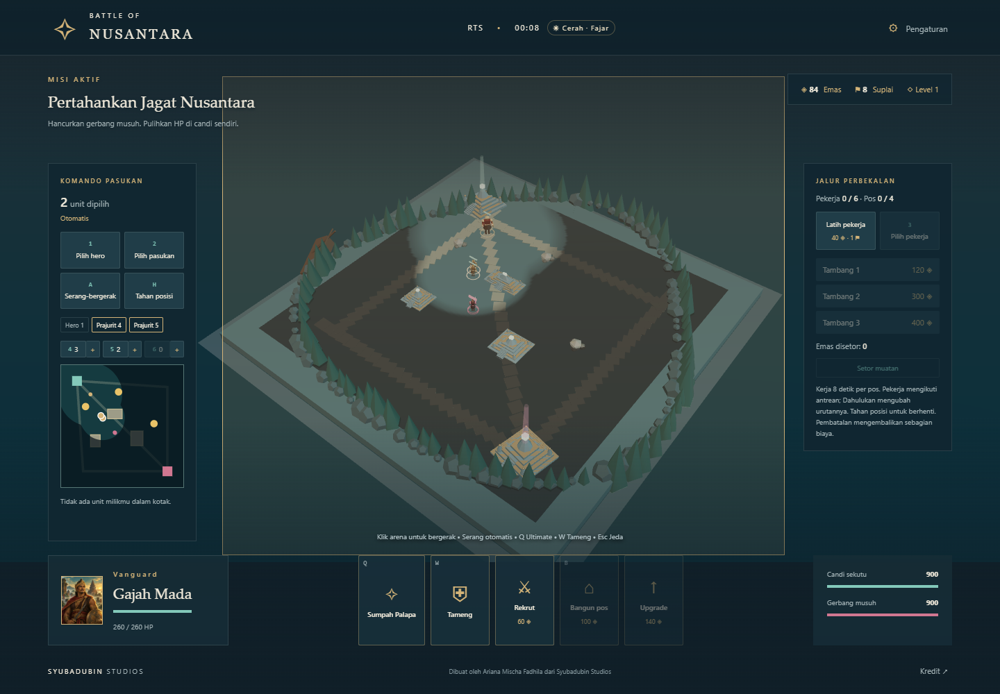

## Kabut perang

Pada RTS Skirmish, musuh hanya terlihat di dalam pandangan timmu. Candi melihat sejauh 24 langkah; hero 26, prajurit 18, pekerja 14, pos selesai 20, dan fondasi 8. Unit rekan LAN memperluas pandangan bersama yang sama. Arena menampilkan wilayah yang belum dijelajahi dengan gelap dan wilayah yang pernah dilihat dengan redup; peta taktis menggelapkan semua yang berada di luar pandangan saat ini. Tambang, reruntuhan, dan gerbang musuh selalu ditampilkan.

Musuh yang tersembunyi sama sekali tidak dikirim ke klienmu. Intai dengan hero, tempatkan prajurit di depan, atau bangun pos untuk mengawasi jalur masuk. Reruntuhan tidak menghalangi pandangan, dan musuh tidak dibatasi kabut. MOBA Arena dan Adventure tidak memakai kabut.

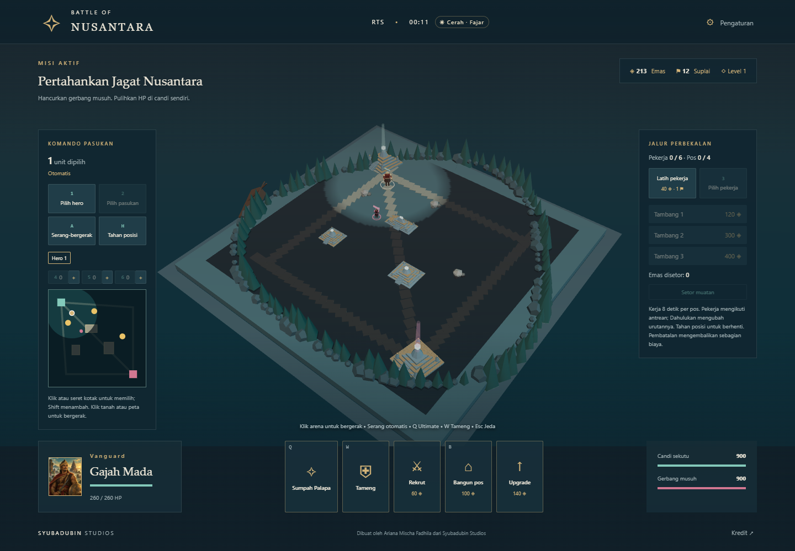

## Pekerja dan pos penyetoran

Klik **Latih pekerja** pada panel perbekalan. Maksimal enam pekerja per pemain. Tekan **3** untuk memilih pekerja sendiri, kemudian pilih **Tambang 1/2/3** melalui panel, peta, atau penanda emas pada arena. Pekerja tidak bertempur; lindungi mereka dengan pasukan. Tambang berisi 120, 300, dan 400 emas, dibagi semua pemain.

Pekerja menambang selama dua detik untuk mengambil maksimal 20 emas, membawa muatan ke candi atau pos hidup terdekat, menyetor, lalu kembali menambang. Tambang berkurang saat muatan diambil; kas bertambah saat disetor. Setelah tambang habis dan muatan disetor, pekerja menunggu. **H** menghentikan pekerjaan dengan tetap menyimpan muatan. **Setor muatan** mengantarkan muatan lalu berhenti. Pekerja yang gugur kehilangan muatan dan mengembalikan satu suplai.

Tekan **B** atau **Bangun pos**, kemudian klik lokasi pada arena/peta. Harga 100 emas, maksimal empat pos bersama. Lokasi harus berada dalam radius 55 dari candi sekutu, di luar radius 13 candi, serta bebas dari unit, pos lain, tambang, dan reruntuhan. Kotak di arena menunjukkan jejak bangunan; server tetap memvalidasi saat klik. Lokasi tidak valid tidak menghabiskan emas. **Esc** membatalkan mode penempatan.

Fondasi berbiaya 100 emas dan mulai dengan 44 HP. Pekerja diam milikmu yang terdekat otomatis ditugaskan; jika tidak ada, pilih pekerja lalu tekan **Kerjakan pos**. Konstruksi membutuhkan 80 tick kerja (8 detik), di luar perjalanan, dan menambah HP menuju 220 tanpa menghapus kerusakan tempur. Beberapa pekerja tidak mempercepat progres. Perintah bergerak, tahan, menambang atau setor muatan menghentikan konstruksi; progres dan muatan tetap tersimpan. Tugaskan kembali pekerja milikmu untuk melanjutkan. Pos selesai maupun fondasi dapat dihancurkan musuh; kehancuran oleh musuh tidak mengembalikan biaya.

Pekerja otomatis mencari depot lain jika posnya hancur. Pos tidak menghasilkan emas pasif; pendapatan dasar tetap 3 emas/detik.

Pos menghalangi gerakan: unit mengitari bangunan dan pekerja menyetor dari luar. Jalur diperbarui saat pos dibangun atau hancur. Perintah gerak baru ke dalam pos ditolak; tujuan lama yang tertutup bangunan dialihkan ke tepinya. Pos rendah tidak menghalangi serangan jarak jauh. Titik muncul pemain dan unit rekrutan dilindungi dari pembangunan.

Hanya pos selesai yang menerima setoran. Setelah target selesai, dibatalkan atau hancur, pekerja aktif melanjutkan fondasi milikmu yang paling awal ditempatkan, terjangkau dan belum ditangani pekerja hidup. Jika tidak ada pekerjaan, pekerja diam. Perintah tahan, bergerak, menambang dan setor muatan menghentikan kelanjutan otomatis sampai ditugaskan kembali; penempatan fondasi baru tetap dapat menugaskan pekerja diam. Pekerja baru perlu perintah Kerjakan pos pertama untuk fondasi yang sudah ada. Gunakan **Batalkan pos** untuk menghapus fondasi milikmu dan membuka tapaknya. Pengembalian = pembulatan ke bawah dari 75 × sisa tick kerja / 80; fondasi baru mengembalikan 75 emas, progres setengah mengembalikan 37. Tombol menampilkan jumlah dari simulasi. Pos selesai, hancur atau milik pemain lain tidak dapat dibatalkan. Pengubahan urutan antrean belum tersedia.

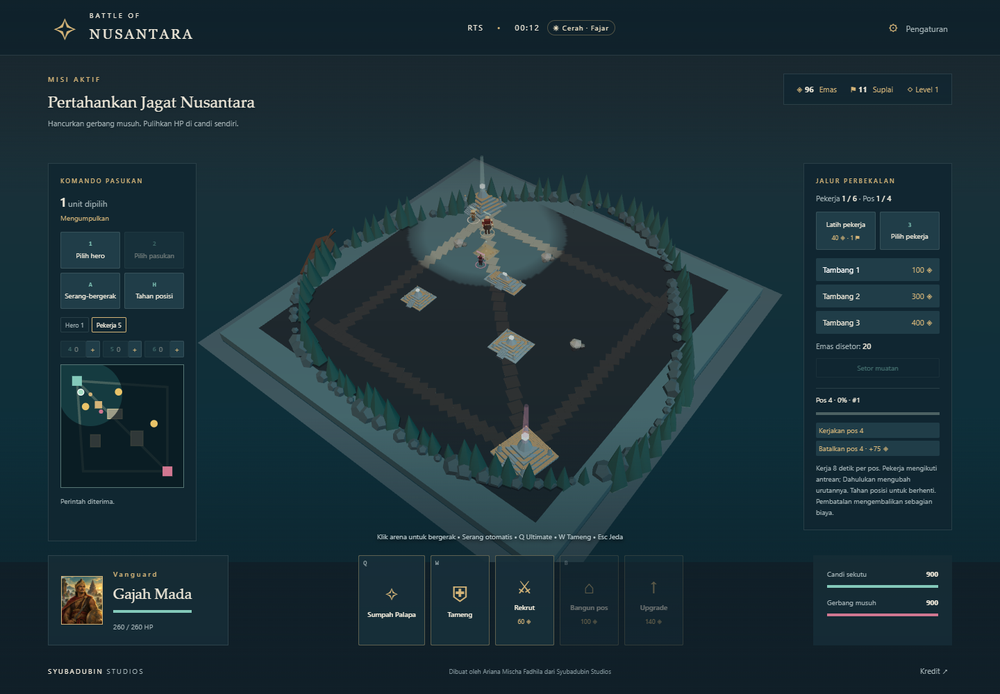

### Urutan antrean

Fondasi yang belum selesai menampilkan nomor antrean. Pekerja yang selesai bekerja mengambil fondasi milikmu bernomor terkecil yang belum ditangani. **Dahulukan pos** memindahkan fondasi ke **#1**; urutan fondasi lain tetap. Perintah ini tidak menghentikan pekerja yang sedang bekerja: gunakan **Kerjakan pos** untuk itu. Setiap pemain memiliki antrean sendiri.

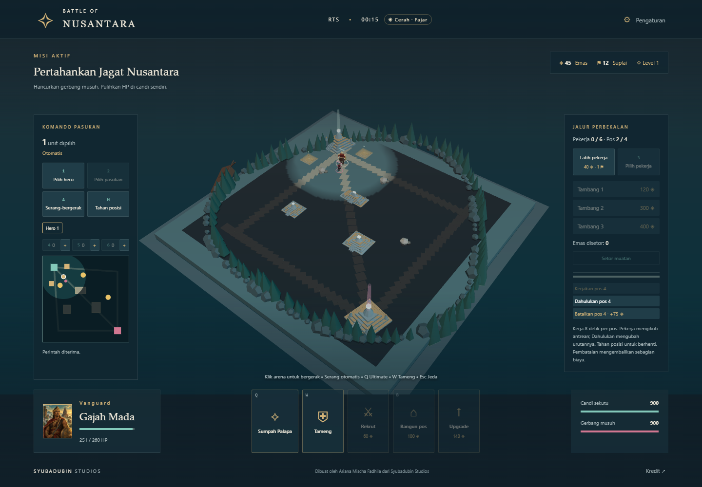

## LAN dua pemain

1. Host menjalankan `dotnet run --project src/BattleNusantara.Server -c Release --no-launch-profile --urls http://0.0.0.0:5080`.
2. Kedua pemain membuka alamat IP host, misalnya `http://192.168.1.10:5080`, atau memakai aplikasi desktop.
3. Di **Mulai petualangan**, buka **Bermain bersama**. Masukkan alamat host yang dapat dijangkau. Browser menggunakan koneksi server-ke-server dari host Blazor; desktop menghubungi alamat itu langsung.
4. Pemain pertama membiarkan kode kosong lalu membuat ruang. Pemain kedua memasukkan kode enam karakter yang terlihat di bagian atas permainan.
5. Pilihan mode pembuat ruang berlaku untuk keduanya. Ekonomi dan tujuan dibagi; hero serta cooldown berbeda.

Gunakan jaringan tepercaya; server tidak ditujukan untuk internet publik. Maksimum 32 ruang aktif, 100 unit per simulasi, sepuluh pemain (lima di MOBA) dan delapan penonton per ruang. Kode ruang dapat dipakai tanpa akun.

## Akun dan matchmaking

Buka **Mulai petualangan → Akun dan matchmaking**. Isi nama akun (3–20 huruf, angka, atau garis bawah) dan kata sandi minimal 8 karakter, lalu pilih **Daftar akun baru**, atau **Masuk** bila sudah punya. Akun terikat pada server yang tertera di bagian itu; ubah dahulu alamat server di **Bermain bersama** bila bermain di server lain. Kamu tetap masuk di perangkat ini selama tujuh hari atau sampai memilih **Keluar dari akun**.

Setelah masuk, bagian ini menampilkan jumlah pertandingan dan kemenanganmu serta tiga hasil terakhir. Hasil dicatat saat pertandingan ruang berakhir, hanya untuk pemain yang sudah masuk. Pilih mode dan hero, lalu tekan **Cari pertandingan**: kamu menunggu sampai pemain lain yang sudah masuk mencari mode yang sama, lalu kalian berdua ditempatkan di ruang baru. **Batalkan pencarian** keluar dari antrean; pencarian tanpa pasangan ditutup setelah dua menit.

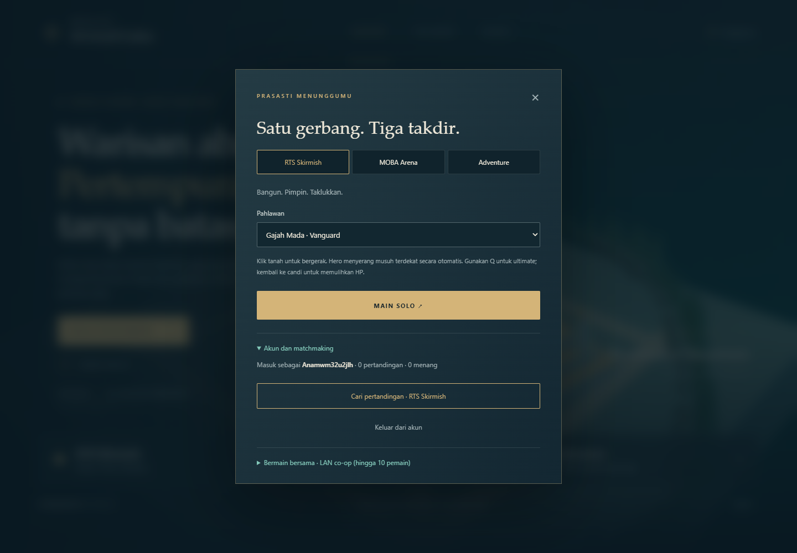

Belum ada reset kata sandi: bila lupa, buat akun baru. Pada server HTTP biasa kata sandi dikirim tanpa enkripsi, jadi gunakan akun hanya di jaringan yang kamu percayai.

**Sambung ulang.** Jika koneksi terputus, permainan menampilkan "Menyambung ulang…" dan mencoba mengembalikanmu ke kursimu selama sekitar 20 detik; server menahan kursi selama 60 detik. Jika gagal, kembali ke menu dan gabung lagi dengan kode ruang. Memilih **Akhiri permainan** berarti keluar dengan sengaja: kursimu langsung dibebaskan, heromu dihapus, dan prajurit, pekerja serta posmu berpindah ke rekanmu. Pada MOBA, sekutu AI menggantikanmu. Ruang tanpa pemain selama 60 detik ditutup.

**Menonton.** Masukkan kode ruang lalu pilih **Tonton ruang**. Penonton melihat apa yang dilihat tim sekutu, tidak mengambil kursi pemain, dan tidak dapat memberi perintah.

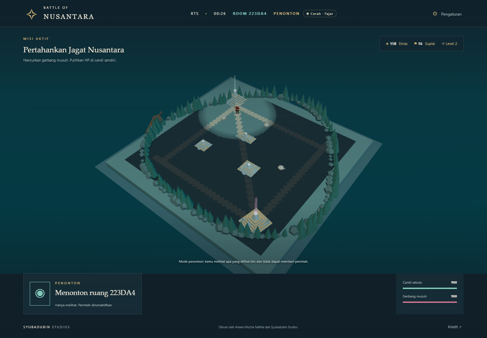

## Pengaturan dan pemecahan masalah

Bahasa, kualitas grafis, pengurangan animasi, sinematik pembuka, dan volume ambience disimpan di localStorage. Audio sintesis dimulai setelah interaksi pengguna. Mode hemat daya mengurangi resolusi rendering dan mematikan bayangan/partikel. Kredit dapat dihentikan dengan hover atau fokus; pengurangan animasi mengubahnya menjadi area gulir biasa.

Jika arena kosong, periksa dukungan WebGL2 dan akselerasi GPU. Jika aset hilang setelah checkout parsial, jalankan `npm ci` dan `npm run vendor`; GLB harus tersedia di `src/BattleNusantara.UI/wwwroot/models/`. Untuk kegagalan LAN, periksa alamat, firewall port 5080, dan kapasitas ruang. Jangan menggunakan `0.0.0.0` sebagai alamat tujuan pemain.

## Build distribusi

Cara termudah memasang adalah installer dari halaman Releases. Untuk membuatnya sendiri (memerlukan Inno Setup 6):

```powershell
./scripts/package.ps1
```

Skrip itu mem-publish game desktop dan server LAN secara mandiri (win-x64) lalu membuat `artifacts/installer/BattleNusantara-<versi>-win-x64-setup.exe` beserta berkas SHA-256-nya. Installer memasang ke `%LOCALAPPDATA%\Programs\Battle of Nusantara` tanpa hak administrator, sehingga server dapat menulis basis data akunnya di folder `Server\data`. Pintasan "Battle of Nusantara LAN server" menjalankan server pada `http://0.0.0.0:5080`.

Distribusikan seluruh direktori hasil publish, termasuk aset. WebView2 tetap diperlukan untuk desktop. Hanya Adventure solo yang dapat disimpan (lihat di bawah); memuat ulang atau menutup sesi solo lainnya mengakhiri permainan.

## Dunia, cuaca, dan sinematik pembuka

Setiap pertandingan dibuka dengan gerakan kamera lima detik; tekan tombol apa pun atau klik untuk melewatinya, atau hilangkan centang **Sinematik pembuka** di Pengaturan. Label di samping jam pertandingan menunjukkan cuaca dan waktu. Satu hari berlangsung enam menit dan cuaca berganti tiap 45 detik: cerah, kabut, hujan, atau badai. **Kabut dan badai memperpendek pandangan** (menjadi 80% dan 75%) semua unit; gelap dan hujan hanya tampilan. Bila **Kurangi animasi** aktif, tidak ada sinematik, hujan yang jatuh, maupun kilat; label tetap memberi tahu cuacanya. Suara mengikuti pertandingan: hujan terdengar, dan lapisan tegang dengan dentum genderang muncul saat unit terluka.

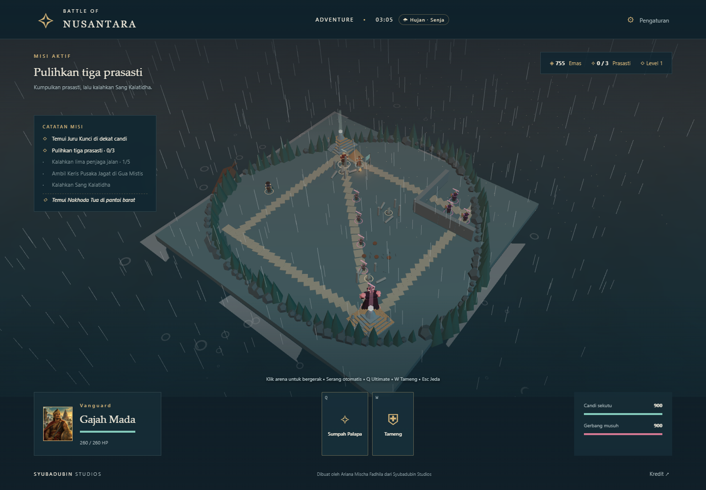

## Bertanya kepada Juru Kunci

Di Adventure, setelah bertemu Juru Kunci, berdirilah di dekatnya saat tidak ada dialog yang tampil. Sebuah panel menawarkan tiga pertanyaan. Jawabannya berasal dari naskah. Bila server tempatmu bermain memiliki model bahasa, jawabannya disusun model itu dan diberi label **jawaban AI**; jika tidak, atau bila model lambat atau gagal, yang tampil adalah teks naskah berlabel **naskah**. Pada game desktop tanpa server, jawabannya selalu dari naskah. Bertanya tidak pernah mengubah pertandingan.

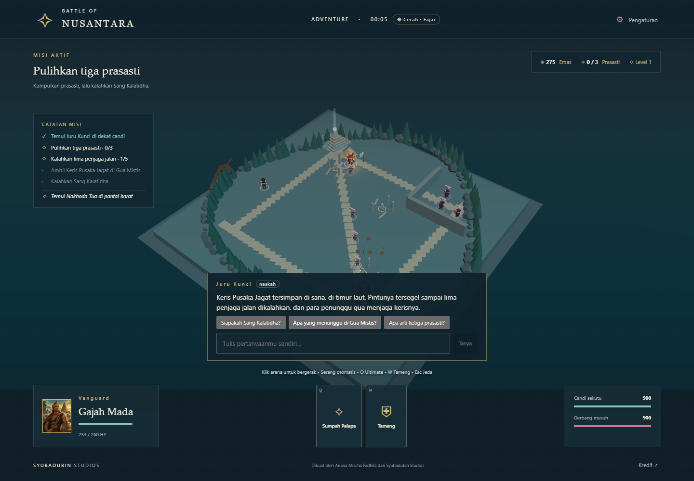

## Hero dan ultimatenya

Enam hero dapat dimainkan. Gajah Mada, Cut Nyak Dien, Nyi Roro Kidul, dan Penjaga Republik memakai **ledakan** di sekeliling diri yang juga sedikit memulihkan HP. **Satria Bledhek** (faksi Pahlawan Super) melepas petir ke musuh terdekat yang melompat ke paling banyak lima musuh lain di dekatnya, lalu berlari 60% lebih cepat selama empat detik. **Rara Angkasa** terbang menerjang musuh terdekat dalam jangkauan, menghantam semua di sekitarnya dengan gelombang kejut yang membuat mereka goyah, dan hanya menerima separuh kerusakan selama empat detik. Keduanya hero orisinal buatan game ini.

## Nakhoda Tua

Di Adventure, berjalanlah ke pantai barat untuk menemui Nakhoda Tua. Ia memberi tugas sampingan yang berubah tiap permainan: mengumpulkan serpihan kapalnya atau mengusir arwah laut, tiga atau empat. Menyelesaikannya memberi 100 emas dan +40 HP maksimum; tugas ini tidak wajib. Saat berdiri di dekat Nakhoda atau Juru Kunci, kamu dapat memilih pertanyaan atau **mengetik sendiri** (hingga 160 karakter). Tanpa model bahasa di server, pertanyaan ketikan dijawab dari teks naskah lewat kata kunci.

## Suara

Dialog bersuara dalam bahasa yang dipilih; hilangkan centang **Suara dialog** di Pengaturan untuk hanya membaca. Musik mengikuti pertandingan dan menguat saat pertempuran dimulai. Kabut dan badai kini memperpendek jarak pandang semua pihak di semua mode.

## Tameng

Tekan **W** atau tombol **Tameng** di mode apa pun. Hero memulihkan 20% HP maksimum dan hanya menerima separuh kerusakan selama 4 detik. Jedanya 12 detik dan terpisah dari ultimate.

## Level MOBA

Hero memperoleh pengalaman dari pasukan, hero, dan menara musuh yang tumbang dalam jarak 25 langkah darinya, dan naik sampai level 6. Setiap level menambah 25 HP dan 4 serangan; bilah emas tipis di bawah HP menunjukkan kemajuannya. Hero AI di kedua sisi bertambah kuat setiap menit. Menara menembak pasukan lebih dahulu daripada hero, jadi majulah di belakang gelombangmu. Hero musuh di jalur timur dapat menyerang Naga Basuki; jika mereka yang memberi pukulan terakhir, musuh mendapat Restu, yang terlihat pada bilah sumber daya.

## Misi Adventure

Catatan misi di sisi kiri memuat lima misi. Temui Juru Kunci di dekat candi, kalahkan lima penjaga jalan untuk membuka segel Gua Mistis di timur laut, ambil Keris Pusaka Jagat di dalamnya (+15 serangan), dan pulihkan tiga prasasti. Baru setelah itu perisai Sang Kalatidha sirna. Setiap misi memberi 60 emas. Dialog muncul di atas HUD; **Lanjut** melewati satu baris, dan baris juga berganti sendiri tanpa menjeda permainan.

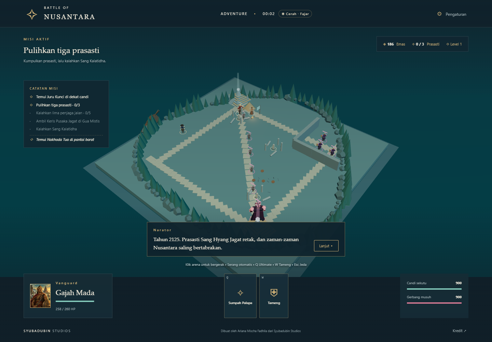

**Menyimpan.** Pada Adventure solo, tekan **Esc** lalu pilih **Simpan permainan**. Dari menu utama, **Mulai petualangan → Lanjutkan simpanan Adventure** melanjutkannya dengan hero yang sama. Tersedia satu slot simpanan, tersimpan di profil browser atau profil pengguna desktop ini. Simpanan yang rusak ditolak dan dihapus.

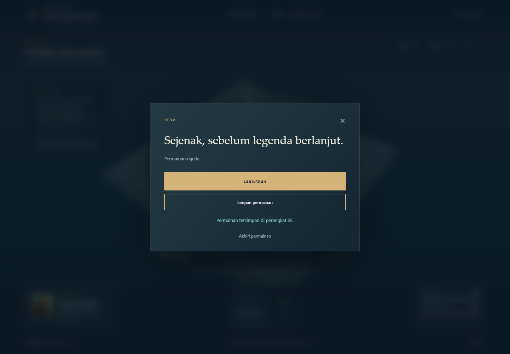
